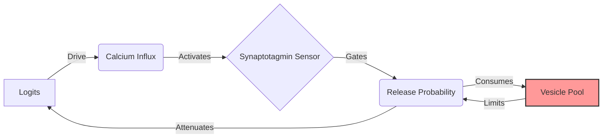
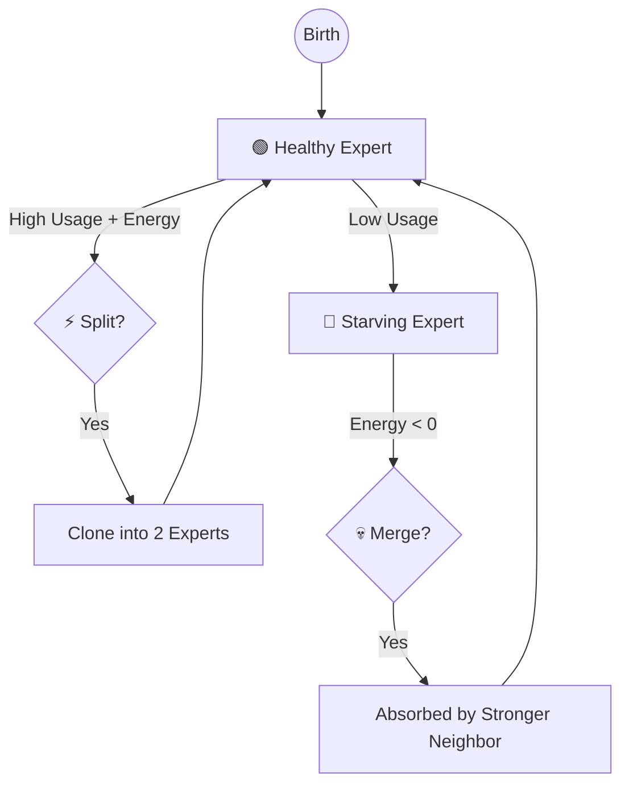

# Bio-Inspired Nanochat

> **"What if a Transformer had a metabolism?"**

[](https://www.python.org/downloads/)
[](https://pytorch.org/)
[](./LICENSE)

This research fork of Nanochat adds state to Transformer attention. During cached generation, release and recovery change the attention bias applied to individual keys. The standard chat engine keeps Hebbian writes off. Training can enable fast-weight updates and an expert split/merge controller. [Upstream Nanochat](https://github.com/karpathy/nanochat) · [Generation path](bio_inspired_nanochat/engine.py) · [Training path](scripts/base_train.py)

## 📊 Project Status

This is an **active research project** implementing 11+ bio-inspired mechanisms with systematic evaluation and optimization. See our comprehensive planning documents:

- 📋 [**Full Roadmap**](.beads/) — `br ready --json` lists claimable work
- 🧬 [**CMA-ES Optimization Plan**](PLAN_TO_USE_CMAES_FOR_HYPERPARAMETER_EXPLORATION_AND_OPTIMIZATION_ACROSS_ALL_BIO_INSPIRED_FEATURES.md) - Systematic hyperparameter tuning (10 params wired in Phase 1; ~48 planned across two phases)
- 🎯 [**Feature Predictions**](CLAUDE_SONNET45_PREDICTIONS_ON_WHICH_NEW_BIO_INSPIRED_IDEAS_WILL_WORK_BEST_OR_NOT.md) - Evidence-based analysis of which mechanisms will work
- 🚀 [**New Features Roadmap**](NEW_RADICALLY_NEW_BIO_INSPIRED_FEATURES_TO_ADD_IN_MODULAR_WAY.md) - Detailed specs for upcoming mechanisms

**Implementation Status:**
Status legend: ✅ shipping (on the live model path, tested) · 🚧 partial/landing · 🔮 aspirational (roadmap).

**Evidence reviewed 2026-11-22.** A depth-10 vanilla model trained on two RTX 4090s. Its 150-step FineWeb smoke run processed 9.83M tokens and recorded 2.4480 validation bits per byte (bpb). The GPU records also include two 50-step kinetics runs. The matched D1 FineWeb experiment that would establish a benefit from the biology is outstanding. [GPU runbook](docs/epic_runbooks.md) · [Results registry](results/registry.jsonl) · [Experiment specification](docs/ablation_matrix.md)

The most informative CPU comparisons answer different questions. On 614,400 WikiText-2 tokens per seed, the final-normalization diagnostic recorded 1.9971 bpb for vanilla and 1.9588 for the corrected mechanisms-off scaffold across three seeds. That diagnostic has no corrected `bio_all` arm. In a separate 5,120-token smoke run across all 17 dense columns and two seeds, vanilla averaged 0.956949 and `bio_all` 0.961701 on 512 evaluation tokens. All 16 comparisons returned `null`. Five MoE columns also completed two training steps on each of two seeds. [Scaffold diagnostic](results/scaffold_diagnosis_2026-10-07.json) · [Dense screening results](results/toy_screening_2026-10-13_verdict.md) · [MoE smoke](results/structural_smoke_2026-10-13.json)

- ✅ **Core Synaptic Mechanisms** — presynaptic release (faithful Hill dynamics), online Hebbian fast-weights (opt-in), and the structural MoE lifecycle all run on the live path.
- ✅ **Stochastic release · BDNF metaplasticity · dual fast/slow weights** — implemented and toggleable.
- ✅ **Fused presynaptic kernels** — `native_presyn` selects Rust on supported CPU paths and Triton on supported CUDA paths. At the recorded FP32 decode shapes on one 4090, Triton improved release time 6.84× and cached synaptic-model decode 1.88× over eager execution. [Accepted GPU benchmark](results/presyn_live_rtx4090.json) · [Rust decode benchmark](results/presyn_rust_decode_bench_2026-10-13.json)
- 🚧 **Systematic optimization** — The CPU held-out-text pilot ran four generations of six candidates. The distributed LM objective can synchronize optimizer updates across different candidates. Their independent fitness and the proposed FineWeb GPU search remain open (`0xd.1`, `idh4`). [CPU pilot](results/cmaes_phase1_lm_2026-10-13.json) · [Audit](docs/bridge_plan.md)
- 🚧 **Rigorous Evaluation** — the statistical layer (paired t / Wilcoxon, bootstrap + Student-t 95% CIs, multi-seed aggregation) ships in `bio_inspired_nanochat/eval_stats.py`; the full D1 GPU benchmark-matrix *run* is still pending.
- ✅ **Fail-closed certificate-policy model cards** — `certificate_bundle.py` strictly composes declared-identity stability, retention, predictive-calibration, tropical-radius, and configured-timescale evidence into a bounded same-process authorization; serialized manifests are audit/report inputs only and cannot recreate live runtime attestation. Well-formed failed, stale, fallback-covered, or out-of-scope evidence is rendered transparently and refused; malformed input is rejected before artifacts are created. No passing production-model card is bundled. See [`docs/certified_model_card.md`](docs/certified_model_card.md).

---

## ⚔️ Tale of the Tape: Silicon vs. Carbon

| Feature | Standard Transformer | Bio-Inspired Nanochat |
| :--- | :--- | :--- |
| **State during chat** | KV cache stores prior keys and values. | Presynaptic release and recovery also modulate cached attention. |
| **Working memory** | Attention reads the available context. | An opt-in Hebbian probe can write fast weights. Its deciding toy experiment missed the recall threshold. |
| **Diversity** | The sampler controls temperature. | Vesicle depletion changes attention bias. Its effect on generated repetition remains unmeasured. |
| **Capacity** | Dense layer shapes stay fixed. | An optional training controller can split, merge, or reset experts. |
| **Optimization** | Uses the upstream training recipe. | Phase-1 CMA-ES can search ten synaptic hyperparameters. |
| **Kernels** | Standard Transformer attention. | PyTorch reference plus optional Rust CPU and Triton CUDA paths. |

---

## 🧠 The "Wetware" Stack: From Biology to Math

We map specific cellular mechanisms from the [Synaptic Cleft](https://en.wikipedia.org/wiki/Chemical_synapse) directly to tensor operations. This architecture is grounded in neuroscience literature and the blueprints found in `prompts/`.

### 1. Presynaptic Biophysics (The Sender)
*The mechanism of "Fatigue" and "Boredom"*

**The Biology**: Neurons run on batteries (ATP). If a neuron shouts too much (fires continuously), it runs out of neurotransmitter vesicles (chemical ammo). It *must* rest to reload.

**The Math**: We track a fluid reservoir `RRP` (Readily Releasable Pool) for every attention head. High attention scores drain the pool.

**Effect on attention.** Release depletes the available pool and changes the logits used to compute attention. Refill allows the same key to receive attention again. Whether this improves diversity in generated text requires a controlled repetition measurement.

**Implementation.** The PyTorch reference is `SynapticPresyn.release_canonical`. On supported CUDA configurations, the Triton backend accelerates deterministic FP32 single-query decode at the configured top-k width. The golden and backend-parity tests exercise the frozen decode trajectory across Python, Triton and Rust. [Golden trajectory](tests/test_presyn_golden.py) · [Parity tests](tests/test_presyn_backend_parity.py)
- **Triton GPU kernel** (`bio_inspired_nanochat/kernels/presyn_fused.py`) accelerates supported FP32 single-query decode on RTX 4090. [Clean-checkout acceptance run](results/presyn_live_rtx4090.json)
- **Rust CPU kernel.** With `native_presyn=1`, `release_canonical` uses the native deterministic step for supported single-query CPU decode. [Rust source](rust_src/src/presyn.rs)



### 2. Postsynaptic Density (The Receiver)
*The mechanism of "Working Memory"*

**The Biology**: "Neurons that fire together, wire together." A transient thought becomes a memory only if it is important (high activity) and the brain has energy to "write" it down (Consolidation).

**The Math**: Weights are split into $W_{slow}$ (Long-term) and $W_{fast}$ (Short-term).
$$ y = x(W_{slow} + \underbrace{W_{fast} + \text{Hebb}(x, y)}_{\text{The Scratchpad}}) $$

**The Effect (hypothesis, not demonstrated)**: "infinite local context" — define a variable at the start of a sentence and recall it at the end through the fast weights, without attending back to it. The pre-registered deciding experiment (bead `hwxb.9`, `results/hebbian_chunked_regime_2026-10-07_preregistered.json`: 2 layers × 64 dims, associative recall up to 16 pairs, 5 seeds × {Hebbian on, off} × {chunked, full training}, 2,000 steps) found ON − OFF = +0.010 recall under chunked training and reading against a 0.016 minimum detectable effect, with the negative, planted-witness and attention-baseline controls all passing. By its decision rule **online Hebbian plasticity is opt-in since 2026-10-07** (`enable_hebbian=False` by default; the D1 matrix tests it as the `add_hebbian` column). Caveat for the next design: chunked truncated-BPTT training at chunk 8 did not learn the task in either arm (final loss 3.24 vs 0.35 with full forwards), so that regime could not show a benefit; full-trained models read with or without chunking show ON − OFF +0.034 ± 0.101 over 5 seeds (exploratory, not significant).

**Mechanisms**:
- ✅ **BDNF Metaplasticity**: activity-dependent learning-rate modulation with gain `1 + bdnf_scale·BDNF` whenever Hebbian plasticity is enabled (`bdnf_scale=1.0` by default); set `bdnf_scale=0` to ablate, or `bdnf_gamma>0` to override the gain.
- ✅ **Dual-Weight Differentiation**: separate fast-cache vs slow-storage timescales (`W_fast` / `W_slow`).
- ✅ **CaMKII/PP1 Bistable Latch** (opt-in via `bistable_latch`, `sax.2`): a Lisman-style switch — CaMKII autophosphorylation (Hill self-excitation) + mutual cross-inhibition with PP1 over a basal phosphatase floor — with PP1 folded into the consolidation gate. Gives genuine **hysteresis**: a supra-threshold pulse latches the synapse ON and it *stays* after the input drops; sustained LTD flips it OFF (tested in `tests/test_bistable_latch.py`). Default-off keeps the legacy CaMKII threshold gate.

### 3. Structural Plasticity (The Life Cycle)
*The mechanism of "Economy & Efficiency"*

**The Biology**: The brain is a ruthlessly efficient economy. It doesn't keep billions of idle neurons on payroll. Useful regions get more resources (Neurogenesis); idle regions are demolished (Pruning).

**The Math**: A **Synaptic Mixture-of-Experts (MoE)** with a per-expert **energy metabolism** and a **health-based lifecycle** (health = utilization × energy). The "bank-account" framing below is a metaphor for these real mechanisms (there is no literal accounting/`bankruptcy`/`IPO` code):
*   **Energy cost** ("taxation"): firing draws down an expert's energy (`energy_use`); idling lets it refill (`energy_fill`).
*   **Utilization** ("income"): being routed raises utilization, which feeds the health score.
*   **Merge** ("bankruptcy"): persistently low-health experts are merged into stronger neighbors.
*   **Split** ("IPO"): high-health experts clone into weak slots.

With `sm_function_preserving=1`, a split clones the parent and gives each twin a `−ln 2` routing-logit bias. In the dense, zero-noise test with a negligible destination, the relative output change is below 10⁻⁵. The default `fp_divergence_noise=0.02` lets the twins diverge. Sparse routing, a previously active destination, or merging distinct experts can change the output. [Continuity tests](tests/test_function_preserving_splitmerge.py)

When `use_neuroscore` is enabled, NeuroScore fitness (below) is blended into that health signal so credit assignment — not just utilization × energy — drives these decisions.

With `homeostasis_guards` enabled, the training controller ramps in the seeded slot over `gate_ramp_forwards`, compensates the pair's routed mass, floors per-expert energy and resets optimizer moments on the affected router/genome rows. These guards are opt-in.

**Research question.** Can training-time expert reallocation improve held-out loss at a fixed compute budget?

The utilization-based controller has a scale problem. A uniformly used expert receives `top_k / num_experts` of routes, while product health approaches `u(1−u)` as energy relaxes. Under the default absolute split threshold of 0.80, a monopoly can look unhealthy. The optional `--sm_health_mode=relative` compares utilization with its fair share. In two-seed, 120-step CPU pilots neither mode fired, even after removing the balance loss. [Default pilot](results/structural_pair_pilot_2026-09-02.json) · [Balance-loss ablation](results/structural_pair_pilot_2026-09-02_balance0.json)

The optional `--sm_health_mode=credit` uses NeuroScore gradient credit relative to the layer mean. After correcting its EMA initialization, the three-seed pilot fired 3–6 splits, 14–15 merges and 2–8 resets per run. Final loss was 0.030–0.050 higher than the fixed controller-free arm on every seed. A separate eight-seed synthetic equal-FLOP study removed dead experts but increased final MSE on every seed. The optional D1 MoE arm compares the credit controller against fixed experts. [Credit pilot](results/structural_pair_pilot_2026-10-07_credit.json) · [Equal-FLOP study](results/structural_nas_evaluation_a2307f21b18f.json)



### 4. Neuromodulation (Global State)

*The mechanism of "Context-Dependent Gating"*

**The Biology**: Real plasticity is gated by a few **global neuromodulators** broadcast brain-wide. Dopamine (DA) signals reward-prediction error; acetylcholine (ACh) signals uncertainty/attention; norepinephrine (NE) signals arousal/novelty.

**The Math** (`hy8.1`, `NeuromodulatoryBus`; opt-in via `--neuromod_enabled=1` or `--syn_cfg.neuromod_enabled=1`, and registered as the `neuromod` ablation mechanism so the pre-registered matrix carries an `add_neuromod` column): three scalars are computed each step from model signals (loss-improvement → DA, predictive entropy → ACh, loss-surprise → NE), EMA-smoothed, and **broadcast** as multiplicative gains onto every synapse:
*   **DA → plasticity gain**: scales the online Hebbian consolidation, so only reward-relevant / loss-reducing updates stick. This is the third factor that bridges Hebbian plasticity to RL (`hy8.2`).
*   **ACh → exploration & attention** (`hy8.5`): scales the stochastic vesicle-release fraction AND an input/attention gain — more uncertainty, more exploration and sharper input sensitivity; the model commits when confident.
*   **NE → global gain / reset**: scales the synaptic output and, on a surprising event, flushes the per-sequence working memory.

Default-neutral (gains 1.0) when off, so it's a no-op unless enabled; telemetry exposes all three levels and gains per step.

### 5. Calibrated Uncertainty and Selective Decoding

*The mechanism of "Know When to Think More—or Not Answer"*

`mc_predict` can sample inference-time stochastic vesicle release and return a predictive distribution with entropy, aleatoric/epistemic decomposition, and logit variance. The mode is opt-in and restores model/synaptic state after sampling. In the canonical 10-seed calibration run — a 1-layer, 32-dim model on a synthetic task, i.e. a pipeline demonstration rather than a language-model result — synaptic MC improved ECE by 34.74% versus MC-dropout and its OOD-AUROC lower 95% confidence bound was 0.9895; it did **not** outperform the free softmax-entropy baseline (ΔECE ≈ 4e-6), and the artifact records its own verdict as `null`.

The default-off `UncertaintyDecodingConfig` turns that measured entropy into an action. `quality_guarded_predict` first routes an uncertain cheap prediction to the reserved full-compute path; if the served distribution remains above a threshold calibrated in nats, it returns an auditable `abstain` or `clarify` directive instead of a token. Every decision logs the adaptive/served entropy, threshold crossings, action trace, bounded predictive-distribution summary, compute plan, and exact ATP debits. On the tiny canonical selective-prediction artifact, the first ≥80%-coverage point per seed retained 770/960 predictions while reducing served errors from two to zero; this is a deterministic demo, not a portable production threshold.

Reachable from serving since 2026-09-03 (beads `wmel.1`/`wmel.2`): `Engine.generate(selective=...)` ends the row and reports an abstention when a step's predictive entropy exceeds the threshold; `python -m scripts.chat_cli -i base -g <tag> -p "..." --selective --max-entropy 1.0` prints `[abstain: predictive entropy X nats > 1.00]`, and `chat_web` accepts `{"selective": true, "max_entropy_nats": 1.0}` in the request and streams an `abstain` event. The entropy is the deterministic-release softmax entropy (the calibration artifact found MC-vesicle entropy indistinguishable from it at toy scale); the threshold is a calibration contract, not a correctness guarantee.

See `docs/theory/stochastic_thermodynamics.md` §§7.4–7.5 and `results/calibration-selective-prediction-86aad7037a51.json` for the full statistical and risk-coverage evidence.

---

## 🚀 Advanced Bio-Inspired Features (Roadmap)

The table below identifies which proposals run in the model and which have a measurable control.

**Synaptic Genome Embedding (Xi):** Each MoE expert owns a compact learned genome vector `Xi` (size `SynapticConfig.xi_dim`). One shared learned decoder maps each 4-D row to six bounded phenotype values: fatigue and energy-recovery rates, CaMKII/PP1 gains, calcium retention, and calcium influx. The bounds imply positive `tau_c` and `tau_rec`, so SGD cannot decode invalid kinetics. This keeps the expert-specific parameter cost at `O(num_experts · xi_dim)` rather than `O(num_experts · num_kinetics)`. Set `xi_dim=0` for the MoE-stage `moe_no_genome` control: the decoder bias still learns one phenotype, but every expert shares it.

The D1 columns name planned comparisons. Exploratory modules have their own evidence requirements.

| # | Feature | Switch | Evidence path |
|---|---|---|---|
| 1 | Stochastic vesicle release | `SynapticConfig.stochastic_train_frac` (mechanism `stochastic_release`, default on) | D1 leave-one-out column `bio_no_stochastic_release` |
| 2 | Endocytosis ring buffer | the DELAY queue inside the presynaptic recurrence; no separate switch. Rab5/7 staging is not implemented | only through `bio_no_presyn` (inseparable from presyn) |
| 3 | Septin-style lateral inhibition | `SynapticConfig.barrier_strength` (mechanism `septin_barrier`, default on); implemented as a global distance barrier, not a windowed inhibition | D1 column `bio_no_septin_barrier` |
| 4 | Rab/SNARE code-based routing | not implemented (no code) | none — roadmap only |
| 5 | Doc2 dual sync/async channels | `SynapticConfig.doc2_gain` (mechanism `doc2`, default on) | D1 column `bio_no_doc2` |
| 6 | Synaptic genome embedding (Xi) | `SynapticConfig.xi_dim` (mechanism `genome`, default on in MoE) | MoE stage column `moe_no_genome` |
| 7 | CaMKII/PP1 bistable latch | `SynapticConfig.bistable_latch` (opt-in) | D1 column `add_bistable_latch` |
| 8 | Cellular-automata initialization | `--init_type` in `base_train` | Exploratory recipe comparison. [Decision and archived CSVs](docs/ca_init_decision.md) |
| 9 | Gauge-reversible cross-pollination | research modules (`separation_gauge.py`, `ultrametric_memory.py`) that `GPTSynaptic` does not import | exploratory, off the live path |
| 10 | Simplicial / higher-order attention | research modules (`mgr_variants.py`, `xpoll.py`) that `GPTSynaptic` does not import | exploratory, off the live path |
| 11 | Ultrametric routing | opt-in `attention_type="ultrametric"` on the vanilla `GPT` (`gpt.py`); not part of `GPTSynaptic` | exploratory; no bio-matrix column (it is not a synaptic mechanism) |

The ablation registry validates prerequisites for the implemented switches. Rab/SNARE remains a proposal, and the separate research modules need their own experiment before their effects can be attributed to the synaptic model. [Ablation registry](bio_inspired_nanochat/ablation_registry.py)

See [NEW_RADICALLY_NEW_BIO_INSPIRED_FEATURES_TO_ADD_IN_MODULAR_WAY.md](NEW_RADICALLY_NEW_BIO_INSPIRED_FEATURES_TO_ADD_IN_MODULAR_WAY.md) for detailed specifications.

---

## 🔬 Deep Dive: The Math of the Synapse

For the researchers, here are the governing equations implemented in `synaptic.py` and `neuroscore.py`.

> **These are the *live* equations.** As of the presyn unification (`8j9.2`), the model's
> attention path runs `SynapticPresyn.release_canonical`, which implements exactly the faithful
> dynamics below — closing the long-standing gap where these equations were documented but the
> live code used a cheaper sigmoid approximation.

### 1. Calcium Dynamics (The Integrator)
Calcium $C$ acts as a leaky integrator of the incoming attention signal (Logits $L$), coupled to a fast calcium **buffer** $B$ (a parvalbumin/calbindin analog that absorbs and re-releases calcium).

$$ C_{t} = e^{-1/\tau_c} \cdot C_{t-1} + \alpha_{ca} \cdot \text{softplus}(L_t) - \alpha_{on} C_{t-1}(1 - B_{t-1}) + \alpha_{off} B_{t-1} $$
$$ B_{t} = e^{-1/\tau_b} \cdot B_{t-1} + \alpha_{on} C_{t-1}(1 - B_{t-1}) - \alpha_{off} B_{t-1} $$

### 2. The Release Probability (The Gate)
The probability $P_{release}$ that a vesicle is actually released depends on the Calcium level (detected by Synaptotagmin) versus the clamp (Complexin).

$$ P_{release} = \sigma(3 \cdot \text{Syt}(C) + 2 \cdot P_{primed} - 2 \cdot \text{Complexin}) \cdot \sigma(\text{Logits}) $$

Where $\text{Syt}(C)$ is a Hill equation modeling the calcium sensor's sensitivity (Syt1 fast + Syt7 slow, plus a Doc2 facilitation term):
$$ \text{Syt}(C) = 0.7\frac{C}{C + K_{d,\text{fast}}} + 0.3\frac{C}{C + K_{d,\text{slow}}} + g_{\text{doc2}}\,\sigma(4(C - 0.12)) $$

### 3. Vesicle Release & Depletion (The Limiter)
The released amount is the release probability scaled by the available vesicles in the Readily Releasable Pool ($RRP$). Since $P_{release}\in[0,1]$, this is bounded by the pool ($R_t \le RRP_t$) — the faithful reading of $W_{eff}=\min(P,RRP)$.

$$ R_t = P_{release} \cdot RRP_t $$
$$ RRP_{t+1} = RRP_t - R_t + \text{RefillRate} $$

The released signal is scaled by an energy-gated AMPA amplitude $q = \sigma(\beta_q (E - 0.5)) \cdot q_{max}$ and enters the attention bias alongside a septin-like distance term.

### 4. Hebbian Learning (Fast Weights + Gated Consolidation)
Low-rank eligibility traces $U, V$ accumulate co-activity each step. Fast weights decay and absorb the trace (the short-term scratchpad). Consolidation into the slow weights is gated by CaMKII and modulated by BDNF metaplasticity:

$$ \Delta W_{slow} = \eta_{slow}\,(1 + \gamma\,\text{BDNF})\,\overline{U V^{T}}\;\cdot\;\underbrace{\big(\sigma(\text{CaMKII} - 0.5) - 0.3\big)}_{\text{CaMKII threshold gate}} $$

The gate opens as CaMKII rises past its threshold. **By default** PP1 is tracked as the opposing "erase" signal but is not in the gate. Enabling `bistable_latch` (`sax.2`) switches the gate to the true bistable form $\sigma(\beta\,(\text{CaMKII}-\text{PP1}))$ and replaces the linear CaMKII update with a self-exciting Lisman switch (hysteresis; latched long-term retention robust to quiescence) — see the [Bistable Latch](#2-postsynaptic-density-the-receiver) mechanism above.

### 5. NeuroScore Dynamics (The Credit Assignment)
In `neuroscore.py`, we calculate the evolutionary fitness of each expert using three metrics:

*   **Efficiency**: Performance per unit of metabolic cost.
    $$ \text{Eff}_i = \frac{\text{Contribution}_i}{\text{Energy}_i + \epsilon} $$
*   **Specialization**: How unique is the expert's input distribution compared to the global average?
    $$ \text{Spec}_i = 1 - \cos(\mu_{expert}, \mu_{global}) $$
*   **Resilience**: Stability of the expert's contribution over time (inverse variance).
    $$ \text{Res}_i = \frac{1}{\text{Var}(\text{Contribution}_i) + \epsilon} $$

When `use_neuroscore` is enabled (default-off), these three metrics are combined into a per-expert fitness that is blended into the health signal driving Split / Merge / Reset (`de5l`). With it off, the lifecycle uses utilization × energy alone and NeuroScore is an observability metric.

---

## 🧬 Evolution in Silicon: Systematic Hyperparameter Optimization

The default CMA-ES search covers ten presynaptic parameters. The eight-generation copy-task pilot gained 0.00078 against a seed-noise floor of 0.0021. Its objective stayed near uniform prediction. A separate CPU held-out-text pilot ran four generations of six candidates. A D1 FineWeb search and out-of-sample confirmation remain open (`idh4`). [Copy-task result](results/cmaes_phase1_rerun_2026-10-07.json) · [Held-out-text result](results/cmaes_phase1_lm_2026-10-13.json)

The ten default dimensions are `tau_c`, `alpha_ca`, `syt_fast_kd`, `syt_slow_kd`, `doc2_gain`, `complexin_bias`, `prime_rate`, `unprime_per_release`, `nsf_recover`, and `lambda_loge`. The CLI also declares nine postsynaptic and four structural dimensions, making 23 distinct entries in `--search-space full`. The default candidate model uses dense blocks with Hebbian writes disabled. A subsystem search needs a model that actually exercises its parameters. [Search spaces and candidate construction](scripts/tune_bio_params.py)

**Proposed second phase.** The original plan proposed 38 additional dimensions and a ~$2,000 allocation. Its staged and joint runs were conditional on Phase 1 succeeding (`fg7`, `scq`). The proposed groups were
- **Calcium Group** (8 params): Buffering, sensor kinetics
- **Vesicle Group** (9 params): Priming, endocytosis, SNARE
- **Postsynaptic Group** (7 params): Hebbian, BDNF, CaMKII/PP1
- **Structural Group** (8 params): Energy, health, routing
- **Kernel Compat Group** (6 params): Rust-specific parameters

The planning document also proposed a 70% quality / 30% performance composite. The CPU LM pilot used held-out bpb.

See [PLAN_TO_USE_CMAES_FOR_HYPERPARAMETER_EXPLORATION_AND_OPTIMIZATION_ACROSS_ALL_BIO_INSPIRED_FEATURES.md](PLAN_TO_USE_CMAES_FOR_HYPERPARAMETER_EXPLORATION_AND_OPTIMIZATION_ACROSS_ALL_BIO_INSPIRED_FEATURES.md) for the complete 15,000-word plan including:
- Detailed parameter inventory with biological justification
- Search space design and encoding strategies
- Fast proxy objective with learning-curve extrapolation
- Distributed evaluation harness design
- Budget tracking and go/no-go checkpoints
- Risk mitigation and sensitivity analysis

### Quick Start with CMA-ES

```bash
# (Recommended) Sanity gate before expensive runs
uv run python -m scripts.tune_bio_params sanity --seed 1 --device cpu

# Phase 1: Optimize top-10 parameters (10D)
uv run python -m scripts.tune_bio_params optimize \
  --seed 1337 --device cuda --generations 50 --popsize 10 \
  --run-dir runs/cmaes/top10

# Resume from the latest checkpoint
uv run python -m scripts.tune_bio_params optimize --run-dir runs/cmaes/top10 --resume

# Stagnation / early-stop policy (defaults: 20 gens, <1% improvement, action=stop)
uv run python -m scripts.tune_bio_params optimize \
  --run-dir runs/cmaes/top10 --stagnation-action sigma_reset
```

The runner supports the following operations.

- Distribute candidates across ranks. The LM optimizer can synchronize gradients across different candidates, so independent candidate fitness still needs a serial-versus-distributed check (`0xd.1`). [Research gate](docs/bridge_plan.md)
- ✅ Save `progress.jsonl`, `best_params.json`, and `es_state.json` (+ per-generation replay states) under `--run-dir`; legacy pickle checkpoints are refused
- ✅ Log scalars/histograms/covariance heatmap to TensorBoard under `--run-dir/tb/`

---

## ⚡ High-Performance Multi-Backend Architecture

Bio-Inspired Nanochat targets **dual RTX 4090** training and inference. `native_presyn` selects fused Triton or Rust implementations on supported inputs. Constructing the dataclass directly defaults this field to false unless configured. Fresh `base_train --synapses=1` explicitly enables it, and resume reads the checkpoint configuration. The native CPU extension must match the Python checkout. [Training defaults](scripts/base_train.py) · [Backend dispatch](bio_inspired_nanochat/synaptic.py)

**Why training needs no backward kernel (2026-10-07).** The presynaptic state recurrence is detached by default, so a query's release depends on its own drive only through an elementwise expression of that drive and the *gathered pre-update edge state*. Every multi-query forward therefore runs the exact causal scan with no autograd (`_scripted_detached_presyn_scan`, or a fused backend) and records those edge constants; `_DetachedScanReleaseGrad` returns the scan's values unchanged and differentiates `presyn_edge_release` for all queries at once in backward. Forward values are bit-identical to recording the loop and parameter gradients agree to ~5e-7 relative. On CPU this cut the scan's backward from ~400 ms to ~36 ms per bio_all 2L/128d step (B=8, T=256).

### Kernel Backends

1. **Python reference / live path** ✅
   - `SynapticPresyn.release_canonical` — the differentiable, golden-locked dynamics; multi-query blocks go through the TorchScript scan `_scripted_detached_presyn_scan` (CPU and CUDA) with the one-pass gradient above.

2. **Triton GPU kernels** ✅ (verified and benchmarked on NVIDIA GeForce RTX 4090, behind `native_presyn`)
   - Location: `bio_inspired_nanochat/kernels/presyn_fused.py`
   - `presyn_detached_scan_kernel` (l7c9 / jyb.2): one program per (batch, head) row advances a whole query block in one launch — training and prefill, deterministic or stochastic (block-level draws from the private train RNG). It replaces ~50 small kernels per query per layer, i.e. ~1M launches per D1 forward. `tests/test_presyn_scan_kernel.py` checks it against the scripted scan under both `TRITON_INTERPRET=1` and live CUDA on RTX 4090 (outputs, all state planes, the DELAY queue, the EMA, recorded edges, drive gradient; ~1e-6), with a planted negative.
   - `presyn_live_decode_kernel` accelerates FP32, deterministic, no-grad cached decode. On a clean RTX 4090 run, release plus log-bias injection at `B=4,H=8,Tk=2048,K=32` fell from 1.090 to 0.159 ms (6.84×). Model decode with a 512-token prefix and 64 generated tokens fell from 4.245 to 2.262 ms/token (1.88×). Both comparisons use the eager synaptic model as the baseline. [Accepted benchmark](results/presyn_live_rtx4090.json)

3. **Rust CPU kernels** ✅ (behind `native_presyn` and `native_genetics`)
   - Location: `rust_src/src/presyn.rs`, `rust_src/src/moe.rs`
   - `presyn_detached_scan_cpu` (jyb.9): the same multi-query block contract, rows in parallel with rayon, usable in **training** (the one-pass gradient supplies the drive gradient) and prefill. It consumes the private train RNG in exactly the scripted loop's order, so the two CPU paths agree to float32 rounding (`tests/test_presyn_scan_kernel.py::test_rust_scan_matches_the_scripted_scan`). Measured one thread: a 64-query block at 193–256 keys fwd+bwd 60 → 18 ms; full bio_all 2L/128d train step 1262 → 925 ms.
   - `presyn_release_canonical_cpu` (`ylo2`): one-query eval decode with zero-copy `StateBuffer::InPlace` mutation and L1-tiled (`L1_TILE=512`) SIMD background updates (**3.47×–7.12× faster than PyTorch across `T_keys=256..4096`**, `results/presyn_rust_decode_bench_2026-10-13.json`), parity-locked in `tests/test_presyn_rust_dispatch.py`.
   - `accumulate_router_stats_cpu` & `update_metabolism_cpu`: dispatched live from `SynapticMoE.forward` via `bio_inspired_nanochat/kernels/dispatcher.py` when `native_genetics=True` on CPU, preserving exact `aux_loss` gradients (`tests/test_backend_dispatcher.py`).
   - Built by `uv sync --extra cpu --dev` (maturin backend).

### Performance Optimizations (In Progress)

Our dual-4090 optimization roadmap includes:
- 🚧 **FlexAttention/FlashAttention Evaluation** - Compare SDPA vs FlexAttention vs FlashAttn2/3
- 🚧 **NCCL/P2P Tuning** - Optimize DDP for PCIe (no NVLink) with bucket sizes and grad overlap
- ✅ **Memory Optimizations** - bf16 autocast, chunked checkpointed vocabulary cross-entropy, tied embeddings
- ✅ **Triton kernel fusion** — multi-query scan profiled on a 4090 and FP32 cached decode benchmarked against eager synaptic execution. [D1 profile](results/profiles/d1_4090_profile_2026-10-14.json) · [Decode benchmark](results/presyn_live_rtx4090.json)
- 🚧 **Inference Fastpath** - KV cache reuse + cudagraphs for steady-state decode
- 🚧 **CI Performance Guardrails** - Automated regression testing

Target: **90%+ GPU utilization** on dual 4090s for both training and inference.

---

## 📊 Rigorous Evaluation Framework

We're implementing systematic bio vs vanilla evaluation with statistical rigor:

- **Benchmark matrix design**: `docs/eval_benchmark_matrix.md`
- **Standardized run harness**: `python -m scripts.eval_matrix --help`

### Benchmark Matrix

**Quality Metrics:**
- **Perplexity** - Validation loss on FineWeb-Edu
- **Long-Context** - Needle-in-a-Haystack (NIAH) retrieval accuracy, swept over length × needle depth (implemented: `synthetic_tasks.niah_accuracy_by_length`, wired into `eval_matrix` as `niah_acc`; sweep to 4k/8k for large models)
- **Calibration** - Expected Calibration Error (ECE)
- **MoE Health** - Expert specialization (Gini), dead expert fraction
- **Memory** - Associative recall on synthetic tasks

**Performance Metrics:**
- **Training** - Tokens/sec, GPU utilization, peak memory
- **Inference** - Latency (prompt + decode), throughput, KV cache efficiency

**Throughput budget.** At D1 scale, `bio_all` must train within 2.0× vanilla step time and decode within 1.5× vanilla latency at matched conditions. The October dual-4090 same-shape sweep measured 96,181 tok/s for vanilla and 37,429 tok/s for bio at batch 16 per rank and sequence length 1,024. That is a 2.57× training slowdown over five measured steps after two warmups. The `infer` rows time full-sequence forwards. The D1 cached-decode budget still requires a vanilla comparison. [GPU measurements](results/scale_memory_2x4090_2026-10-14.jsonl) · [Benchmark implementation](scripts/scale_memory.py) · [Budget definition](bio_inspired_nanochat/perf_regression.py)

### Experimental Design

- **Configs**: the 17 pre-registered dense columns of `docs/ablation_matrix.md` (3 anchors, 4 leave-one-out, 10 add-one-in) plus the opt-in MoE stage (`moe_fixed`, the lifecycle arm `moe_splitmerge`, and the MoE-only mechanisms `moe_no_metabolism`, `moe_no_genome`, `moe_add_glial_homeostasis`, which are inert on dense blocks); `python -m scripts.matrix_launch` derives every cell's `base_train` command from the spec and `eval_matrix` scores the checkpoints
- **Seeds**: 2 matched seeds for pipeline smoke, 3 for research estimates, and at least 6 non-zero matched pairs before a two-sided exact-Wilcoxon-backed directional claim (5 pairs cannot reach `p < 0.05`)
- **Tests**: paired-bootstrap CI + paired t-test + Wilcoxon signed-rank with Holm correction, Student-t 95% aggregate CIs, and explicit supported/null/regression/insufficient-evidence verdicts — implemented in `bio_inspired_nanochat/eval_stats.py` (run `uv run python -m bio_inspired_nanochat.eval_stats <summary.csv>` on an `eval_matrix` output)
- **Budget** — the proposed screen uses 10M training tokens per cell. Confirmation uses 100M per cell subject to a 72 GPU-hour cap. Holding tokens fixed answers a data-efficiency question. A compute-efficiency claim also needs an equal-time or equal-compute comparison. [Ablation design](docs/ablation_matrix.md)

### Reproducibility

The launcher constructs per-cell training commands from the registry. `scripts.eval_matrix matrix` scores the resulting checkpoints. Pass `--eval-bpb` to record the primary metric. Seeded summaries, configuration hashes and archived checkpoints allow a run to be traced when the artifacts are retained. Compiled dual-GPU crash/resume reproducibility remains an open qualification. [Checkpoint contract](docs/scale_up_checkpointing.md)

Example:
```bash
# Run CORE benchmark evaluation (needs a `base` checkpoint under the nanochat base dir)
uv run --no-sync python -m scripts.base_eval
```

`base_train`, `eval_matrix`, and `tune_bio_params optimize` append schema-validated records to
the tracked `results/registry.jsonl` corpus. Each record carries the harness/artifact run ID,
git SHA, full configuration hash, seed, hardware, dataset identifiers, and canonical metrics.
Inspect accumulated runs without opening the JSONL directly:

```bash
uv run python -m bio_inspired_nanochat.results_registry list --limit 20
uv run python -m bio_inspired_nanochat.results_registry best --metric val_bpb
```

`eval_matrix` and `tune_bio_params optimize` accept `--registry-path`; `base_train` writes to
the default. Set `BIO_RESULTS_REGISTRY` (in `.env` or the environment) to redirect every default
at once — the test suite does this automatically so pytest can never append to the tracked
corpus. Normal research runs should keep the tracked default so results accumulate.

If the eval bundle download fails (e.g. HTTP 403), point the script at a local bundle or a mirror:
```bash
uv run python -m scripts.base_eval --eval-bundle-zip /path/to/eval_bundle.zip
# or
uv run python -m scripts.base_eval --eval-bundle-dir /path/to/eval_bundle/
```

See our evaluation roadmap in `.beads/` (Epic: `bio_inspired_nanochat-gzm`).

---

## 🔬 Biological Parameter Reference

Every aspect of the synapse can be tuned via `SynapticConfig`. These parameters act as the "genome" of the artificial brain.

### Presynaptic (The "Sender")
| Parameter | Default | Bio-Analog | Effect on Model |
| :--- | :--- | :--- | :--- |
| `tau_c` | 6.0 | **Calcium Decay** | How long a neuron stays "excited" after firing. Higher = longer bursts. |
| `prime_rate` | 0.075 | **Vesicle priming** | Controls how quickly vesicles become ready for release. |
| `alpha_ca` | 0.55 | **Calcium Influx** | Sensitivity to attention scores. Higher = easier to trigger release. |
| `syt_fast_kd` | 0.4 | **Synaptotagmin $K_d$** | The threshold for rapid release. Lower = more trigger-happy. |
| `stochastic_train_frac`| 0.12 | **Thermal Noise** | Fraction of query positions that use stochastic vesicle release during training. |
| `stochastic_mode`| `normal_reparam` | **Sampler** | Fast stochastic sampling mode (`normal_reparam`, `gumbel_sigmoid_ste`, or `straight_through`). |
| `stochastic_tau`| 1.0 | **Temperature** | Relaxation temperature for `gumbel_sigmoid_ste` (lower = harder). |
| `stochastic_count_cap`| 8 | **Count Cap** | Max vesicles per edge for stochastic sampling (higher = more compute). |
| `tau_buf` | 4.0 | **Calcium Buffer** | Buffering timescale. Higher = slower calcium dynamics. |
| `tau_prime` | 5.0 | **SNARE Priming** | Vesicle priming timescale. Affects release readiness. |

### Postsynaptic (The "Receiver")
| Parameter | Default | Bio-Analog | Effect on Model |
| :--- | :--- | :--- | :--- |
| `rank_eligibility` | 8 | **Eligibility rank** | Sets the rank of the co-activity trace. |
| `post_trace_decay` | 0.96 | **Trace decay** | Controls retention of the previous trace on each update. |
| `camkii_up` | 0.05 | **Potentiation** | Sets the CaMKII increase rate. |
| `pp1_tau` | 0.985 | **Phosphatase dynamics** | Controls retention of the PP1 state. |
| `bdnf_gamma` | 0.0 | **Metaplasticity** | A positive value overrides `bdnf_scale` when Hebbian writes are enabled. |

### Structural (The "City Planner")
| Parameter | Default | Bio-Analog | Effect on Model |
| :--- | :--- | :--- | :--- |
| `energy_cost_rel` | 0.015 | **Release cost** | Scales the energy cost of vesicle release. |
| `split_health_min` | 0.80 | **Split threshold** | Training-controller flag (`--split_health_min`) selecting candidates for splitting. |
| `router_contrastive_push` | 0.1 | **Router repulsion** | Sets the repulsive part of the router embedding update. |

`SynapticConfig` has 109 fields. The training CLI accepts them through `--syn_cfg.<field>=<value>`. Controller settings have separate flags. The CMA-ES CLI exposes the default 10-dimensional search and optional subsystem spaces described above. [Parameter census](docs/parameter_census.md) · [Training configuration](scripts/base_train.py)
- The biological **genome** is the learned per-expert `Xi` vector (`xi_dim=4`), expanded by one shared decoder to six bounded phenotype kinetics — distinct from the fixed hyperparameters above. `xi_dim=0` is the shared-kinetics ablation.

---

## 💉 The Neurosurgeon's Toolkit (Configuration)

To study a parameter, compare runs with identical seeds, data, token budgets, and model shape. The command below varies two presynaptic settings for exploration. To attribute an effect, vary one at a time or use a factorial design.

```bash
uv run python -m scripts.base_train --synapses=1 --syn_cfg.prime_rate=0.02 --syn_cfg.energy_cost_rel=0.05
```

---

## 🚀 Quick Start

### Prerequisites

- **Python**: 3.14
- **UV**: Latest version for fast dependency resolution
- **GPU**: NVIDIA with CUDA 12.4+ (dual RTX 4090 recommended)
- **RAM**: 32GB+ for large models

### 1. Install the "Wetware"

```bash
# Clone the repository
git clone https://github.com/Dicklesworthstone/bio_inspired_nanochat.git
cd bio_inspired_nanochat

# Create environment with UV
uv venv .venv --python 3.14.2
source .venv/bin/activate  # On Windows: .venv\Scripts\activate

# Choose the extra for the target host. On CUDA Linux use
uv sync --extra gpu

# For a supported CPU Linux host use
uv sync --extra cpu
```

The project build installs the Rust extension. Use the extension built from the same
revision as the checkout. An older installed wheel failed the Quick Start before its
first optimizer update. The frozen CPU extra also failed to resolve on macOS arm64
with Python 3.14.6 because of its Triton dependency. [Runtime audit](docs/bridge_plan.md)

### 1.5. Quality Gate (recommended)

Before pushing changes, run the fast quality gate on the files you touched:

```bash
# Staged changes (pre-commit style)
uv run python -m scripts.quality_gate --mode staged

# Branch diff vs main (pre-push style)
uv run python -m scripts.quality_gate --mode branch --base origin/main
```

What it enforces:

- `uv run ruff check --fix --unsafe-fixes` (and fails if it had to modify files)
- `uvx ty check` (type errors fail; warnings are allowed)
- UBS resource-lifecycle scan (runs via `ubs --category=resource-lifecycle --staged` / `--diff` where possible; branch/CI may scan the whole repo)

Exemptions: if a tool reports a false positive, prefer a narrow, documented suppression
(`# noqa: ...`, `# type: ignore[...]`, or a scoped `ty.toml` exclusion) and create a Beads issue
explaining why the exemption is correct.

### 2. Grow a Brain

`base_train` needs tokenized FineWeb-Edu shards and a trained tokenizer first:

```bash
# data: download 8 shards (~800 MB) and train the 65k BPE tokenizer
uv run --no-sync python -m bio_inspired_nanochat.dataset -n 8
uv run --no-sync python -m scripts.tok_train --max_chars=2000000000
```

Then train a small bio-model. Every setting is a `--key=value` override of the defaults at the
top of `scripts/base_train.py`, and any `SynapticConfig` field is reachable as
`--syn_cfg.<field>=<value>`:

```bash
uv run --no-sync python -m scripts.base_train --synapses=1 --depth=12 --splitmerge_every=1000 \
    --device_batch_size=32 --total_batch_size=524288 --num_iterations=50000 \
    --syn_cfg.tau_rrp=60.0 --syn_cfg.enable_hebbian=1 --syn_cfg.bistable_latch=1 --model_tag=my_first_brain
```

Model width is derived from `--depth` (the nanochat convention). For two GPUs use
`uv run --no-sync torchrun --standalone --nproc_per_node=2 -m scripts.base_train <flags>` (see
`scripts/run_bio_dual4090.sh`); the docstring of `scripts/base_train.py` has a 4-layer,
20-step CPU smoke recipe. The depth-12 example above is a training recipe. The registered D1 headline config is depth 10, width 640 and context 1,024.

**Key Training Flags:**
- `--synapses=1` - Enable the synaptic model (0 = vanilla transformer)
- `--syn_cfg.<field>=<value>` - Override any of the 109 `SynapticConfig` fields; values are typed from the dataclass and validated, so a typo or an opt-in mechanism enabled without its prerequisite fails before training starts. Examples: `--syn_cfg.stochastic_train_frac=0.25`, `--syn_cfg.stochastic_mode=gumbel_sigmoid_ste`, `--syn_cfg.stochastic_tau=0.5`, `--syn_cfg.bdnf_scale=0` (ablate BDNF), `--syn_cfg.enable_hebbian=1` (online Hebbian plasticity, opt-in since 2026-10-07; `bistable_latch`, `enable_stdp` and `neuromod_enabled` need it)
- `--load_cmaes_params=best_params.json` - Overlay a CMA-ES result file instead
- `--splitmerge_every=N` - Expert lifecycle interval (0 = disable; any N > 0 switches the MLPs to `SynapticMoE`)
- `--hebb_chunk_len=N` enables single-process chunked training with truncated backpropagation. Later chunks can read earlier Hebbian writes when plasticity is enabled. The registered toy recall study missed its benefit threshold. [Deciding experiment](results/hebbian_chunked_regime_2026-10-07_preregistered.json)
- `--sm_homeostasis_guards=1` - Ramp freshly seeded experts in and floor their energy after lifecycle events (`uta.6`)
- `--neuromod_enabled=1` - Turn on the DA/ACh/NE bus

### 3. Monitor Vitals (TensorBoard)

```bash
tensorboard --logdir runs/neuroviz
```

**Key metrics to watch** (NeuroViz scalars are namespaced per layer; the `bio_v2/*` scalars come from the telemetry panel):
*   **💓 Heartbeat**: `<layer>/energy_mean` (should stay > 0.5) and `<layer>/health_mean`
*   **🧠 Map**: the router-embedding projector (distinct clusters = specialization)
*   **🌳 Family Tree**: the lineage book of `split` / `merge` / `reset` events per expert
*   **📊 Utilization**: `<layer>/util_mean`, `<layer>/dead_expert_frac`
*   **🎯 Hebbian**: `<layer>/camkii_mean`

### 4. Chat with Your Brain

```bash
# Talk to the base checkpoint step 3 wrote. A base model completes text; it is not instruction-tuned.
uv run --no-sync python -m scripts.chat_cli -i base -g my_first_brain -p "The synapse"

# Or serve it in the browser
uv run --no-sync python -m scripts.chat_web --source base --model-tag my_first_brain --port 8000
```

`-i`/`--source` names the checkpoint directory: `base`, `mid`, `sft`, or `rl`. `sft` and `rl` are
the conversational stages of the full pipeline (`base_train` → `mid_train` → `chat_sft`). No
trained bio checkpoint ships with the repository yet. Steps 3 and 4 were run end to end on CPU on
2026-09-01 (2 FineWeb shards, 4,096-token vocabulary, 8 steps, `--device_type=cpu`); the
`torch.compile` call that had made `base_train` unrunnable on Python 3.14 is now gated.

### 5. Benchmark Bio vs Vanilla

```bash
# Run CORE benchmark evaluation (needs a `base` checkpoint under the nanochat base dir)
uv run --no-sync python -m scripts.base_eval
```

---

## 📂 Anatomy of the Codebase

### Core Implementation
*   **`bio_inspired_nanochat/synaptic.py`** ⚡ **The Physics Engine**: 109-parameter `SynapticConfig` + core dynamics
*   **`bio_inspired_nanochat/gpt_synaptic.py`** 🏗️ **The Body**: Transformer skeleton with synaptic organs
*   **`bio_inspired_nanochat/synaptic_splitmerge.py`** 👼 **The God Hand**: Surgical controller for expert lifecycle
*   **`bio_inspired_nanochat/neuroscore.py`** 🏆 **The Credit Score**: Expert fitness metrics (Efficiency, Specialization, Resilience)

### High-Performance Kernels
*   **`bio_inspired_nanochat/kernels/presyn_fused.py`** 🔥 **GPU Kernel**: default-off live deterministic decode fusion + multi-query detached scan with canonical fallback
*   **`rust_src/src/presyn.rs`** 🦀 **CPU Kernel**: PyO3-native Rust multi-query scan (`presyn_detached_scan_cpu`) and zero-copy L1-tiled single-query decode step (`presyn_release_canonical_cpu`, 3.47×–7.12× faster than PyTorch across `T_keys=256..4096`), dispatched on CPU behind `native_presyn`
*   **`rust_src/src/moe.rs`** 🦀 **MoE Kernel**: Expert routing and metabolism (`accumulate_router_stats_cpu`, `update_metabolism_cpu`), dispatched live from `SynapticMoE.forward` through `bio_inspired_nanochat/kernels/dispatcher.py` behind `native_genetics`
*   **`tests/test_presyn_backend_parity.py`** ✅ **Parity**: one frozen trajectory across Python, Triton, and Rust; `tests/test_presyn_rust_dispatch.py` locks the live CPU dispatch
*   **`tests/test_rust_kernels.py` & `tests/test_backend_dispatcher.py`** ✅ **Native Utilities**: Rust MoE/metabolism validation and live `SynapticMoE` dispatch + gradient parity

**Package footprint (machine-verified by `tests/test_package_footprint.py`, bead `3zsq` / `3zsq.2`):** Of the **101** modules in `bio_inspired_nanochat/`, **49** form the core runtime closure reachable from the 11 user-facing CLI entrypoints (`base_train`, `eval_matrix`, `chat_cli`, `chat_web`, `base_eval`, `mid_train`, `chat_sft`, `tune_bio_params`, `matrix_launch`, `perf_regression_gate`, `enable_synapses`), **16** are evaluation/probe modules used by `scripts/e2e/` and diagnostic scripts, and **36** are standalone/test-only research modules (grouped into `agentic_research`, `geometry_theory`, `decoding_serving`, and `optimization_telemetry` in `tests/test_package_footprint.py`) that no runtime entrypoint imports.

### Visualization & Analysis
*   **`bio_inspired_nanochat/neuroviz.py`** 📸 **The MRI**: Visualizations of brain internal state
*   **`scripts/dashboard.py`** 📊 **State Inspector**: Streamlit inspector (`uv sync --extra viz`, then `streamlit run scripts/dashboard.py`)

### Optimization & Tuning
*   **`scripts/tune_bio_params.py`** 🧬 **The Evolver**: CMA-ES optimizer
*   **`scripts/base_eval.py`** 📊 **Evaluation**: CORE benchmark evaluation

### Utilities
*   **`scripts/enable_synapses.py`** 💉 **The Injector**: Copies a compatible pretrained Nanochat GPT checkpoint into synaptic slow weights, with optional identical MoE expert clones
*   **`scripts/base_train.py`** 🎓 **Training Loop**: Main training script
*   **`scripts/chat_web.py`** 💬 **Chat UI**: Web-based inference interface

### Retrofit an existing checkpoint

Convert the latest vanilla Nanochat GPT checkpoint without overwriting the source. The converter
copies attention and dense MLP weights into the synaptic model (`W_slow` receives the pretrained
MLP matrices), zeros fast/adaptive state, preserves source provenance, and writes a new loadable
checkpoint. The optional smoke finetune proves the biological state activates while logits remain
finite:

```bash
uv run python -m scripts.enable_synapses \
  --source-ckpt /path/to/base_checkpoints/vanilla \
  --source-step -1 \
  --ckpt-out /path/to/base_checkpoints/vanilla_synaptic \
  --finetune-steps 4
```

Add `--use-moe --experts 8 --topk 2` to clone the pretrained dense MLP into every initially
identical expert. This converter intentionally targets architecture-compatible Nanochat GPT
checkpoints; arbitrary Hugging Face families require an explicit architecture adapter.

### Documentation
*   **`prompts/`** 📜 **The DNA**: Theoretical blueprints and research proposals
*   **`.beads/`** 📋 **Project Management** — use `br ready --json` or `bv --robot-triage` for current work.
*   **Planning docs** (root): CMA-ES plan, feature roadmap, predictions

---

## 🗺️ Research Roadmap

### Epics

The main scientific milestone is a matched D1 comparison on FineWeb-Edu (`hwxb.3`, `hwxb.5`). Both GPUs and the input pipeline have already supported smoke training. An operator still needs to archive the full vanilla reference, screen the registered mechanisms, and apply the confirmation rule. A useful model release also needs a retrievable checkpoint, provenance and a reproducible generation example (`hwxb.6`, `vap.6`). [Scale-up decisions](docs/scale_up_phase0_decisions.md) · [Runbook](docs/epic_runbooks.md)

| Question | Recorded evidence | Open work |
|---|---|---|
| Does the synaptic model improve quality? | Three-seed scaffold diagnosis and two-seed dense pipeline smoke. | D1 matched baselines and conditional mechanism contrasts (`hwxb.5.2`, `hwxb.5.3`). |
| Does the model learn or remember online? | Five-seed Hebbian protocol missed its recall threshold. Credit-driven expert lifecycle increased loss on 3/3 toy seeds. | Mechanism-specific hardening and D1 evidence (`hwxb.4.1`–`.4.4`). |
| Is it efficient? | RTX 4090 release/decode fusion and D1 training measurements on one and two cards. | Matched training and cached-decode budgets, precision, memory and inference work (`6pj`, `4nk`, `5rh`, `h4j`), and scaling curves (`74f.6`). |
| Can the bio parameters be tuned? | Ten parameters wired and a small CPU held-out-text objective exercised. | Phase-1 GPU search on FineWeb (`idh4`). Phase 2 is proposed. |
| Can someone use the results? | Training, checkpoint conversion, CLI/web inference, and reduced-model Lean proof artifacts exist. | Redistributable D1 weights, fresh-clone reproduction, measured capabilities and a published verdict (`hwxb.6`, `vap.6`). |

`br ready --json` lists claimable work; `bv --robot-triage` gives the ranked view.

---

## 📚 References & Inspiration

### Neuroscience
- Tsodyks, M., & Markram, H. (1997). "The neural code between neocortical pyramidal neurons depends on neurotransmitter release probability." *PNAS*.
- Hebb, D. O. (1949). "The Organization of Behavior." Wiley.
- Takeuchi, T., et al. (2014). "The synaptic plasticity and memory hypothesis." *Neuron*.

### Machine Learning
- Vaswani, A., et al. (2017). "Attention is All You Need." *NeurIPS*.
- Schlag, I., et al. (2021). "Linear Transformers Are Secretly Fast Weight Programmers." *ICML*.
- Fedus, W., et al. (2022). "Switch Transformers." *JMLR*.

### Optimization
- Hansen, N. (2016). "The CMA Evolution Strategy: A Tutorial." arXiv:1604.00772.

### Related Projects
- [Nanochat](https://github.com/karpathy/nanochat) - Original minimal GPT implementation
- [FlashAttention](https://github.com/Dao-AILab/flash-attention) - Fast attention kernels
- [Model Guided Research](https://github.com/agentic-research/model-guided-research) - Mathematical geometry for LLMs

---

## 🧬 Legacy Nanochat Features
*(Inherited from the base [Nanochat](https://github.com/karpathy/nanochat) repo)*

This repo remains fully compatible with the original "silicon" workflows:
*   **`speedrun.sh`**: Train a standard static GPT-2.
*   **`scripts/chat_web.py`**: Chat UI.
*   To disable biology, just run without `--synapses` flag.

---

## 📄 License

MIT License (with OpenAI/Anthropic Rider) — see [LICENSE](LICENSE) for details.

---

## 🙏 Acknowledgments

- **Andrej Karpathy** - For the original [Nanochat](https://github.com/karpathy/nanochat) codebase
- **Neuroscience Community** - For decades of synaptic research
- **PyTorch Team** - For Triton and FlexAttention
- **Anthropic** - For Claude Sonnet 4.5 which assisted with planning and documentation

---

## 📬 Contact

- **Issues**: [GitHub Issues](https://github.com/Dicklesworthstone/bio_inspired_nanochat/issues)
- **Discussions**: [GitHub Discussions](https://github.com/Dicklesworthstone/bio_inspired_nanochat/discussions)
- **Twitter/X**: [@dicklesworthstone](https://twitter.com/dicklesworthstone)

---

<p align="center">
  <strong>Built with ❤️ and 🧠 at the intersection of neuroscience and machine learning</strong>
</p>
