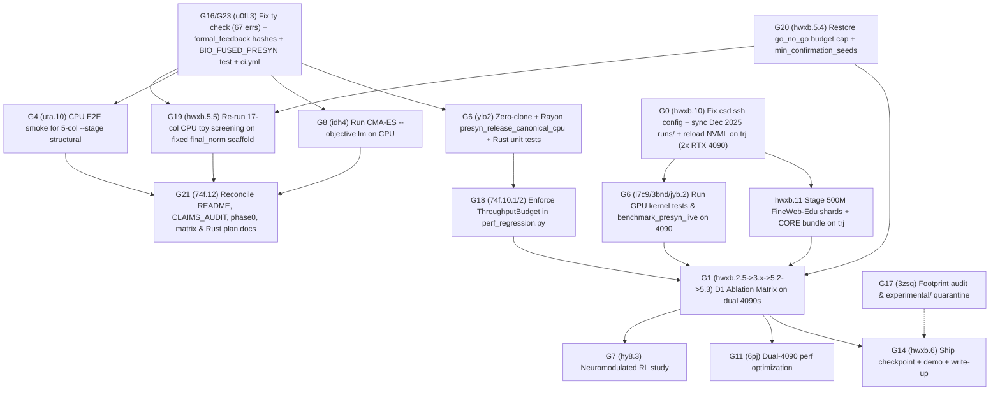

# Bridge Plan — bio_inspired_nanochat

**Reality check history:**
- **2026-09-01 (`db544b2`):** Initial Phase 1–2 reality check ("Bio-Nanochat Reality Check").
- **2026-10-07 (`716cacb`…`1b95827`):** Harness defect fixes, toy screening run, scaffold `final_norm` discovery (`8de4abb`), Rust/Triton multi-query causal scan (`85905ad`, `3956cc3`), CMA-ES LM objective (`e9ff9d6`).
- **2026-10-13 (`1b95827`, current HEAD):** Comprehensive end-to-end `/reality-check-for-project` audit of code, tests, artifacts, fleet hardware (`csd`, `mac-mini-max`, `trj`, `ts1`, `ts2`), docs, and `.beads/`.

**This document:** Phase 2 of `/reality-check-for-project` — the single authoritative plan bridging every gap between what `README.md` and the design specifications promise and what the codebase actually delivers at `1b95827`. Ordered by vision impact, with concrete files, functions, verification gates, and bead mappings.

**Rule this plan follows:** A number in a document must cite a committed artifact; a null or negative result is a first-class result; never weaken a gate to land a change; nothing here creates a dashboard, certificate, or matrix that no live code branches on.

---

## Status 2026-10-13 at `1b95827` (Read First)

| Area / Gap | Ground-Truth Status at `1b95827` | Cited Evidence |
|---|---|---|
| **G0 · Fleet & GPU host `trj`** | **REACHABLE (was misdiagnosed as unreachable); NVML driver reload needed.** From `csd` (`sensedemobox`), `trj` (`threadripperje`, `10.10.10.1` via `mac-mini-max` or Tailscale `100.91.120.17`) is live via `ssh -J mac-mini-max ubuntu@10.10.10.1` and has **2× RTX 4090** (`41:00.0`, `42:00.0`) + `/data/projects/bio_inspired_nanochat` cloned at `1b95827` + intact Dec 2025 `runs/` artifacts. `nvidia-smi` on `trj` currently fails with `Driver/library version mismatch (NVML 595.99 vs kernel 595.91.07)` held by 4 `gunicorn` processes (`bulk_youtube_transcript_optimizer`). Also `ts2` (`thinkstation2`) is directly reachable (`ssh ts2`) with a working GTX 1070. | Live SSH probe `csd -> mac-mini-max -> trj`; `hwxb.10` |
| **G1 · Toy screening vs `final_norm` fix (`8de4abb`)** | **STALE HEADLINE NUMBERS IN DOCS.** `results/toy_screening_2026-10-07_verdict.md` (`vanilla` 1.958, `synaptic_off` 2.028 [+0.069], `bio_all` 2.038 [+0.080] val bpb) was run on `be7344f` **before** `716cacb` (which turned `enable_hebbian` off by default and moved MoE mechanisms to `structural_columns()`) and **before** `8de4abb` (which added the missing final RMSNorm before `lm_head` in `GPTSynaptic`). In `results/scaffold_diagnosis_2026-10-07.json`, `final_norm=True` moved `synaptic_off` from **+0.087 bpb behind `vanilla` to −0.0383 bpb ahead of `vanilla` on all 3 seeds** (`1.9625/1.9513/1.9626` vs `2.0097/1.9969/1.9846`). Yet the 17-column toy screening was never re-run at `1b95827`, and `README.md`, `CLAIMS_AUDIT.md`, and this file still cite the pre-`8de4abb` unnormalized deficit. | `8de4abb`, `results/scaffold_diagnosis_2026-10-07.json` vs `results/toy_screening_2026-10-07_verdict.md` |
| **G2 · Online fast weights (`enable_hebbian`)** | **DECIDED (negative at toy scale).** Pre-registered chunked-regime benchmark (`chunk_len=8`) showed `hebbian_on == hebbian_off` on associative recall (`0.225` vs `0.225`) and worse validation loss (`3.671` vs `3.591`, all 5 seeds positive) at 0.34× throughput. Demoted to opt-in (`enable_hebbian=False`, `bdnf_scale=1.0` gated behind `enable_hebbian`); `add_hebbian` and `add_bdnf` are now distinct `add_one_in` columns. | `716cacb`, `results/hebbian_chunked_regime_2026-10-07_preregistered.json`, `docs/online_learning_status.md` |
| **G3 · Evaluation determinism** | **WORKING.** `GPTSynaptic.forward` defaults `train_mode=None -> self.training` (`5cb1a90`). All 3 CPU benchmarks (`fast_weight_comparison`, `structural_nas_evaluation`, `cmaes_phase1_rerun_2026-10-07`) were re-run under the deterministic regime (`1c8ce91`, `e9ff9d6`). | `5cb1a90`, `1c8ce91`, `tests/test_eval_determinism.py` |
| **G4 · Structural lifecycle (`uta`)** | **WIRED & MEASURED AT TOY SCALE.** NeuroScore EMA bug fixed (`aeaf162`); `sm_health_mode="credit"` fires (`3–6` splits, `14–15` merges, `2–8` resets over 120 steps) with `+0.030…+0.050` loss cost at 2L/64d (`results/structural_pair_pilot_2026-10-07_credit.json`). `structural_columns()` now has 5 MoE columns (`moe_fixed`, `moe_splitmerge`, `moe_no_metabolism`, `moe_no_genome`, `moe_add_glial_homeostasis`). E2E subprocess test of `--stage structural` remains open in `uta.10`. | `aeaf162`, `716cacb`, `results/structural_pair_pilot_2026-10-07_credit.json` |
| **G6 · Presyn recurrence & kernels** | **CPU SCAN LANDED; GPU ACCEPTANCE OPEN.** Detached recurrence no longer builds autograd graphs (`b5325a1`); Rust `presyn_detached_scan_cpu` (`85905ad`, `BIO_FUSED_PRESYN=1`) cuts 2L/128d `seq=256` step time `1633 ms -> 925 ms` (1.77×); Triton `presyn_detached_scan_kernel` (`3956cc3`) passes on `TRITON_INTERPRET=1`. Real CUDA execution on `trj` (`l7c9`, `3bnd`, `jyb.2`, `jyb.3`) awaits NVML reload. | `b5325a1`, `85905ad`, `3956cc3`, `tests/test_presyn_scan_kernel.py` |
| **G8 · CMA-ES hyperparameter tuning (`idh4`)** | **PARTIAL.** Copy-task proxy re-run confirmed No-go (`results/cmaes_phase1_rerun_2026-10-07.json`: all candidates score `6.950 ≈ ln(1024)`). Held-out language-model objective (`--objective lm`, `LMTask` on real shards with `setup_optimizers()`) landed in `e9ff9d6`, but the actual `--objective lm` optimization run has not yet been executed and committed. | `e9ff9d6`, `results/cmaes_phase1_rerun_2026-10-07.json`, `scripts/tune_bio_params.py` |
| **G16 / G23 · Code quality & CI gates (`ty`, `formal_feedback`)** | **REGRESSED AT HEAD (`1b95827`).** Despite `CHANGELOG.md` claiming `ty check` is clean at `716cacb`, `uv run --no-sync ty check` currently **fails with 67 diagnostics** (`tests/test_ablation_matrix.py` lines 112–113, 222–225 from `716cacb`; `tests/test_tune_bio_params.py` lines 166–168 from `e9ff9d6`). Furthermore, `scripts.formal_feedback` and `tests/test_formal_feedback.py` **fail** because `formal/lean/proof_artifacts.json` has stale SHA-256 hashes for 4 files modified in `716cacb`. And setting `BIO_FUSED_PRESYN=1` in the shell breaks `tests/test_ablation_registry.py` because `SynapticConfig.native_presyn` reads `BIO_FUSED_PRESYN` at import time. | `uv run --no-sync ty check`, `uv run --no-sync python -m scripts.formal_feedback` |
| **G20 · Confirmation-pass statistical power deadlock** | **SELF-BLOCKING SPEC BUG.** `ablation_matrix.go_no_go()` (`bio_inspired_nanochat/ablation_matrix.py:414-431`) refuses to proceed whenever `2 * 0.5^n * m > 0.05` (exact two-sided Wilcoxon floor under Holm correction). Yet `CONFIRMATION_SEEDS` (`ablation_matrix.py:85`), `docs/ablation_matrix.md`, and `hwxb.5.2.2` still pin `n = 3` seeds (`best_case_p = 0.25 > 0.05`), so `go_no_go()` **unconditionally returns `proceed=False` ("INFEASIBLE design")** and `eval_stats.compare_matrix` forces every 3-seed verdict to `"null"`. | `bio_inspired_nanochat/ablation_matrix.py:85,414-431`, `tests/test_ablation_matrix.py:186-195` |

---

## 1. Gap Register (2026-10-13 Audit)

Severity measures impact on the project's core scientific & engineering promises. "Beads?" indicates whether existing open beads in `.beads/` completely cover the gap.

| # | Gap | Vision Items | Status at `1b95827` | Severity | Beads? | Size |
|---|---|---|---|---|---|---|
| **G0** | **GPU host `trj` access & NVML driver mismatch:** `trj` (2× RTX 4090) IS reachable via `mac-mini-max` (`10.10.10.1` / Tailscale `100.91.120.17`), but `csd`'s `~/.ssh/config` points `trj` to `localhost` and `trj` has an NVML 595.99 vs kernel 595.91.07 mismatch held by 4 `gunicorn` PIDs. | 9, 10, 12, 13, 19 | **BLOCKED ON DRIVER RELOAD** | Critical | Partial (`hwxb.10` had wrong diagnosis) | S |
| **G1** | **Headline bio-vs-vanilla experiment at D1 scale (17 dense + 5 MoE columns):** Harness & launcher ready; zero GPU runs executed yet. | 12, 13, 19 | **NOT STARTED (GPU)** | Critical | Yes (`hwxb.2.5→2.6→3.x→5.2→5.3→6.x`, `4fw`, `gzm`) | XL |
| **G19** | **Post-`8de4abb` (`final_norm=True`) 17-column toy screening & doc sync:** Headline CPU numbers in `README.md`, `CLAIMS_AUDIT.md`, and `results/toy_screening_2026-10-07_verdict.md` come from pre-`8de4abb` (`final_norm` missing) and pre-`716cacb` (`enable_hebbian=True`). `scaffold_diagnosis_2026-10-07.json` proved `synaptic_off` beats `vanilla` by `-0.0383` bpb once normalized, but the 17-column screening was never re-run. | 1, 12, 21 | **STALE ARTIFACT & DOCS** | Critical | Was NO BEAD → now `hwxb.5.5` | M |
| **G20** | **Confirmation-pass statistical power deadlock (`CONFIRMATION_SEEDS` vs `go_no_go`):** `CONFIRMATION_SEEDS` has 3 seeds, where exact Wilcoxon has floor `p = 0.25 > 0.05`. `go_no_go()` unconditionally rejects `n = 3` as `"INFEASIBLE design"`, and `eval_stats.compare_matrix` forces all 3-seed runs to `"null"`. | 12, 16 | **BROKEN CONTRACT** | Critical | Was NO BEAD → now `hwxb.5.4` | S |
| **G16 / G23** | **Regressed CI gates at HEAD (`ty check`, `formal_feedback`, `BIO_FUSED_PRESYN` env collision, `ci.yml` `--no-sync`):** `ty check` fails with 67 diagnostics; `formal_feedback` fails on 4 stale SHA-256 hashes in `formal/lean/proof_artifacts.json`; `BIO_FUSED_PRESYN=1` breaks `test_ablation_registry.py`; `ci.yml` `build-wheel` lacks `--no-sync`. | 21, 23 | **REGRESSED** | High | Was NO BEAD → now `u0fl.3` | S |
| **G2** | **Online fast-weight efficacy (`enable_hebbian`):** Proven null/negative on 5-seed chunked associative recall (`results/hebbian_chunked_regime_2026-10-07_preregistered.json`); now default-OFF (`add_hebbian`/`add_bdnf`). Scale-up check (`hwxb.4.4`) remains open for GPU. | 3 | **DECIDED (CPU NULL) / GPU OPEN** | Major | Yes (`hwxb.4.4`) | M |
| **G3** | **Evaluation determinism (`GPTSynaptic.forward` default `train_mode=None`):** Fixed in `5cb1a90`; CPU artifacts re-run with `measurement_regime` metadata in `1c8ce91`. | 1, 2, 11, 12 | **WORKING (CLOSED)** | — | Closed (`5cb1a90`, `1c8ce91`) | — |
| **G4** | **Structural lifecycle (`uta`):** Credit health mode (`sm_health_mode="credit"`) fires at toy scale (`results/structural_pair_pilot_2026-10-07_credit.json`) and is wired into `structural_columns()` (now 5 MoE columns). Subprocess E2E smoke (`uta.10` step 3) and GPU scale-up (`hwxb.4.3`, `uta.2`) remain open. | 5, 6 | **PARTIAL** | Major | Yes (`uta.10`, `hwxb.4.3`, `uta.2`) | M |
| **G5** | **End-to-end subprocess gate for training scripts:** `tests/test_e2e_quick_start.py` and `tests/test_e2e_matrix_pipeline.py` landed. | 14, 23 | **WORKING (CLOSED)** | — | Closed (`5a27e16`) | — |
| **G6** | **Kernels & exact causal recurrence:** Detached scan (`b5325a1`), Rust CPU scan (`85905ad`), and Triton scan (`3956cc3`) landed on CPU/interpreter. Real RTX 4090 execution (`l7c9`, `3bnd`, `jyb.2`, `jyb.3`, `jyb.10`) and Rust decode row-parallelism (`ylo2`) remain open. | 9, 10 | **PARTIAL (CPU DONE, GPU OPEN)** | Major | Yes (`l7c9`, `3bnd`, `jyb.2`, `jyb.3`, `jyb.10`, `ylo2`) | L |
| **G7** | **Neuromodulation efficacy & RL study:** `add_neuromod` is in the 17-column screening matrix; `hwxb.4.2` and `hy8.3` (RL study) await GPU. | 7 | **UNPROVEN (GPU)** | Major | Yes (`hwxb.4.2`, `hy8.3`) | L |
| **G8** | **CMA-ES on a language-model objective (`idh4`):** Copy-task proxy re-run confirmed No-go (`results/cmaes_phase1_rerun_2026-10-07.json`). `--objective lm` implemented in `scripts/tune_bio_params.py` (`e9ff9d6`), but the `--objective lm` optimization run itself has not been executed/committed. | 11 | **PARTIAL** | Major | Yes (`idh4`) | M |
| **G9** | **Roadmap features evidence mapping:** Resolved in `README.md` §Roadmap (`74f.9`). | 18 | **WORKING (CLOSED)** | — | Closed (`74f.9`) | — |
| **G10** | **Selective decoding / calibrated abstention in serving:** Wired into `Engine.generate(selective=...)`, `chat_cli --selective`, and `chat_web` (`wmel.1`, `wmel.2`). | 8 | **WORKING (CLOSED)** | — | Closed (`wmel`) | — |
| **G11** | **Dual-4090 performance program:** All 9 beads (`6pj`, `j9i`, `2fh`, `4nk`, `5rh`, `94r`, `h4j`, `r2d`, `vwl`) open and awaiting `trj` GPU availability. | 13 | **NOT STARTED (GPU)** | Major | Yes (`6pj` children) | XL |
| **G14** | **Ship a usable checkpoint, inference demo & write-up:** Open under `hwxb.6.1–6.3`, `vap.6`. | 19, 20 | **NOT STARTED (GPU)** | Critical | Yes (`hwxb.6.x`, `vap.6`) | L |
| **G15** | **CI verified green on GitHub / self-hosted runner:** Tracked by `u0fl`, `u0fl.1`, `u0fl.2`. Currently blocked by G16/G23 regressions on `main` (`ty check` and `formal_feedback` fail). | 23 | **REGRESSED / UNVERIFIED** | Major | Partial (`u0fl` + new G16/G23 bead) | S |
| **G17** | **Package footprint hygiene:** 94 top-level modules in `bio_inspired_nanochat/`; 46 reachable from `scripts/` (only 15 from core `gpt`/`gpt_synaptic`/`synaptic`/`synaptic_splitmerge`), 48 unreachable from `scripts/` (test-only/standalone). Tracked by `3zsq`, `3zsq.1`, `3zsq.2` (no file deletion without written permission per Rule 1). | 22 | **OPEN DEBT** | Minor | Yes (`3zsq`, `3zsq.1`, `3zsq.2`) | M |
| **G18** | **Throughput budget & `perf_regression` gate:** Tracked by `74f.10`, `74f.10.1`, `74f.10.2`. | 9, 13 | **IN PROGRESS** | Major | Yes (`74f.10.1`, `74f.10.2`) | M |
| **G21** | **Cross-document & bead specification drift:** (1) `docs/scale_up_phase0_decisions.md` §1/§3.2 says `working_memory_suite` is PRIMARY and `val_bpb` is secondary, contradicting `docs/ablation_matrix.md` and `ablation_matrix.py:455` (`DECISION_PRIMARY_METRIC = "val_bpb"`). (2) `docs/ablation_matrix.md` §4 still says `13 columns × 3 seeds` while §2 says `17`. (3) `hwxb.5.2.1` says `20 columns` instead of `17 dense + 5 structural`. (4) `ablation_matrix.py:44` docstring says `neuromod` is not registered when it is. (5) `docs/eval_benchmark_matrix.md:151` says `base_train.py` lacks CLI overrides for `SynapticConfig`. (6) `TESTING.md:138` claims 27 Rust unit tests in `rust_src` when `cargo test` runs `0 tests`. (7) `PLAN_TO_OPTIMIZE_KEY_HOTSPOTS_USING_RUST_PYO3.md` is a byte-for-byte duplicate of `PLAN_TO_OPTIMIZE_KEY_HOTSPOTS_USING_TRITON.md`. (8) `README.md` L631 still says `96-parameter SynapticConfig` (vs 109) and L191 claims Dec 2025 `runs/` are gone when they exist on `trj`. | 12, 21, 22 | **DRIFTED** | Medium | Was NO BEAD → now `74f.12` | S |

---

## 2. Detailed Resolutions for Active & Newly Discovered Gaps

### G16 / G23 · Restore Green Code-Quality & Formal-Proof Gates on `main` — REGRESSED → WORKING *(Priority 0: do immediately on CPU)*

**Current state at `1b95827`.**
1. `uv run --no-sync ty check` fails with **67 diagnostics**:
   - `tests/test_ablation_matrix.py` lines 112–113 and 222–225 (7 errors): `build_syn_cfg()` returns `SynapticConfig | None`, and the assertions added in `716cacb` access `.enable_metabolism`, `.glial_homeostasis`, `.enable_hebbian`, `.bdnf_scale` without narrowing `None`.
   - `tests/test_tune_bio_params.py` lines 166–168 (60 errors): `kwargs = dict(...)` added in `e9ff9d6` widens the value type to an untyped union, failing `ty` checking on all 20 keyword parameters of `evaluate_candidate_detailed(...)`.
2. `uv run --no-sync python -m scripts.formal_feedback` and `pytest tests/test_formal_feedback.py` fail with `FormalFeedbackError: stale runtime hash` for 4 files modified in `716cacb`:
   - `bio_inspired_nanochat/ablation_matrix.py` (`4b6420f488a7...` → `301fcb4b7b6f...`)
   - `bio_inspired_nanochat/ablation_registry.py` (`62ff0747f7c1...` → `7dc100e1d547...`)
   - `tests/test_ablation_matrix.py` (`399cbc1f3d33...` → `e5a5bb68625f...`)
   - `tests/test_scaleup_ablation_e2e.py` (`9c9056c181cc...` → `f6f50fcd23ce...`)
3. Setting `BIO_FUSED_PRESYN=1` in the shell environment causes `tests/test_ablation_registry.py::test_registry_defaults_match_synaptic_config` and `test_native_presyn_is_a_default_off_backend_valid_in_every_column` to fail because `SynapticConfig.native_presyn` evaluates `decouple_config("BIO_FUSED_PRESYN", default=False, cast=bool)` at class definition time.
4. `.github/workflows/ci.yml` line 211 (`build-wheel`) runs `uv run maturin build --release` without `--no-sync`, causing `uv` to re-resolve and download CUDA PyTorch mid-job after `uv sync --extra cpu --dev`.

**Target state.**
- Fix the type annotations in `tests/test_ablation_matrix.py` and `tests/test_tune_bio_params.py` so `uv run --no-sync ty check` exits 0 with 0 diagnostics.
- Append a new proof-preserving runtime-hash refresh record in `formal/lean/proof_artifacts.json` (after fixing `tests/test_ablation_matrix.py`) so `uv run --no-sync python -m scripts.formal_feedback --run-tests` and `pytest tests/test_formal_feedback.py` exit 0.
- Make `tests/test_ablation_registry.py` resilient to `BIO_FUSED_PRESYN=1` in the outer environment (or read `BIO_FUSED_PRESYN` cleanly) so running the test suite with `BIO_FUSED_PRESYN=1` passes 100%.
- Add `--no-sync` to `uv run --no-sync maturin build --release` in `.github/workflows/ci.yml`.

**Success criteria.**
- [ ] `uv run --no-sync ruff check` exits 0.
- [ ] `uv run --no-sync ty check` exits 0.
- [ ] `uv run --no-sync python -m scripts.formal_feedback --run-tests` exits 0.
- [ ] `BIO_FUSED_PRESYN=1 OMP_NUM_THREADS=1 uv run --no-sync pytest tests/test_ablation_registry.py tests/test_ablation_matrix.py tests/test_tune_bio_params.py tests/test_formal_feedback.py` exits 0.

---

### G0 · Unblock Dual-4090 GPU Host `trj` (`hwxb.10`) — MISDIAGNOSED → READY

**Current state.**
- `trj` (`threadripperje`) is NOT missing or offline. It is reachable from `csd` (`sensedemobox`) through `mac-mini-max` (`ssh -J mac-mini-max ubuntu@10.10.10.1` or Tailscale `100.91.120.17`).
- On `csd`, `~/.ssh/config` currently has a broken stub (`Host trj` -> `HostName localhost`) and lacks `trj_ed25519` (which lives on `mac-mini-max:~/.ssh/trj_ed25519`).
- On `trj`, `/data/projects/bio_inspired_nanochat` is already cloned at `1b95827` (`main`), and two RTX 4090s are attached at PCIe `41:00.0` and `42:00.0`.
- `nvidia-smi` on `trj` currently fails with `Failed to initialize NVML: Driver/library version mismatch (NVML library version: 595.99)` vs loaded kernel module `595.91.07` (`/proc/driver/nvidia/version`), held open by 4 `gunicorn` processes from `/data/projects/bulk_youtube_transcript_optimizer` (PIDs 7365, 13148, 13154, 3020335).
- Additionally, `ts2` (`thinkstation2`, GTX 1070, driver 590.48.01) is directly reachable via `ssh ts2` right now.

**Target state.**
1. Update `~/.ssh/config` on `csd` so `Host trj threadripperje` uses `HostName 10.10.10.1` with `ProxyJump mac-mini-max` (and copy `trj_ed25519` to `csd:~/.ssh/`), enabling direct `ssh trj`.
2. On `trj`, coordinate a brief restart of the `gunicorn` processes (or reboot `trj` / `sudo rmmod nvidia_uvm nvidia_drm nvidia_modeset nvidia && sudo modprobe nvidia_uvm`) so kernel module `595.99` matches userland NVML `595.99`.
3. On `trj:/data/projects/bio_inspired_nanochat`, run `uv sync --extra cuda --dev && uv run --no-sync maturin develop --release --manifest-path rust_src/Cargo.toml` and `uv run --no-sync pytest -m gpu -v`.
4. Copy the surviving December 2025 artifacts (`runs/ca_init_microbench/20251218_054731/`, `runs/cmaes_phase1_10d_*`, `runs/eval_matrix/`) or their summary metadata into tracked `results/` if needed, and correct the false "runs/ is gone" statement in `README.md`, `CLAIMS_AUDIT.md`, and `docs/ca_init_decision.md`.

**Success criteria.**
- [ ] `ssh trj nvidia-smi -L` lists two `NVIDIA GeForce RTX 4090` GPUs.
- [ ] `ssh trj "cd /data/projects/bio_inspired_nanochat && uv run --no-sync pytest -m gpu -v"` passes with 0 failures.
- [ ] `hwxb.10` closed with recorded driver/CUDA/PyTorch versions and GPU test output, unblocking all 20+ downstream GPU beads.

---

### G19 · Re-run the 17-Column Toy Screening on the Fixed (`final_norm=True`, `enable_hebbian=False`) Scaffold & Sync Docs — STALE → CURRENT

**Current state.**
- `results/toy_screening_2026-10-07_verdict.md` and `results/toy_screening_2026-10-07_summary.csv` were generated at `be7344f` (19 columns), before `716cacb` (`enable_hebbian=False`, MoE columns moved to `structural_columns()`) and before `8de4abb` (`final_norm=True` on `GPTSynaptic`).
- In that pre-fix run, `GPTSynaptic` lacked the final RMSNorm before `lm_head`, causing `synaptic_off` to lose to `vanilla` by `+0.069` val bpb (`2.028` vs `1.958`), and `enable_hebbian=True` degraded `bio_all` (`2.038`) and every `bio_no_*` column.
- Commit `8de4abb` proved in `results/scaffold_diagnosis_2026-10-07.json` that with `final_norm=True`, `synaptic_off` beats `vanilla` on all 3 seeds by `-0.0383` val bpb (`1.9588` vs `1.9971` mean).
- Yet `README.md` (L25, L149), `CLAIMS_AUDIT.md` (L13, L77), and `results/toy_screening_2026-10-07_verdict.md` still report the broken pre-`8de4abb` numbers (`+0.069` / `+0.080` deficit), and `CHANGELOG.md` (L45) misquotes `bio_no_bdnf` from that pre-fix CSV as `add_hebbian`/`add_bdnf`.

**Target state.**
- Execute the 17-column dense toy screening (`am.screening_columns()`: 3 anchors + 4 `leave_one_out` + 10 `add_one_in`) × 3 seeds (`1337, 1338, 1339`) at HEAD (`final_norm=True`, `enable_hebbian=False`, `BIO_FUSED_PRESYN=1`) on the same 2L/128d WikiText-2 300-step protocol.
- Commit the updated summary CSV, verdict JSON, and verdict markdown in `results/`.
- Update `README.md`, `CLAIMS_AUDIT.md`, `CHANGELOG.md`, and `docs/bridge_plan.md` to cite the post-`8de4abb` 17-column artifact alongside the pre-`8de4abb` scaffold diagnosis.

**Success criteria.**
- [ ] All 51 cells (`17 columns × 3 seeds`) complete with `status == "ok"` and `recipe_source == "base_train_checkpoint"`.
- [ ] `synaptic_off` vs `vanilla` reflects the `final_norm=True` scaffold, and `add_hebbian` vs `add_bdnf` are measured as distinct columns.
- [ ] Every headline toy-screening number in `README.md` and `CLAIMS_AUDIT.md` matches the committed post-`8de4abb` artifact.

---

### G20 · Resolve Confirmation-Pass Statistical Power Deadlock & Restore Deleted Budget Cap in `go_no_go()` — DEADLOCKED → FEASIBLE

**Current state.**
- `eval_stats.compare_matrix()` (`bio_inspired_nanochat/eval_stats.py:468-474`) requires **both** Holm-adjusted paired t-test `p <= alpha` **and** Holm-adjusted exact two-sided Wilcoxon signed-rank `p <= alpha` (`alpha = 0.05`) to declare `supported_gain` or `supported_regression`.
- For `n` matched seeds, the exact two-sided Wilcoxon p-value has a hard mathematical floor of `2 * 0.5^n`. For `n = 3` (`CONFIRMATION_SEEDS = (1337, 1338, 1339)`), the minimum possible Wilcoxon p-value is `0.25 > 0.05`.
- Worse, commit `ea54808` **accidentally deleted `if hours > cap_gpu_hours:`** from `ablation_matrix.go_no_go()` (`bio_inspired_nanochat/ablation_matrix.py:414-431`) when adding the `best_case_p > CONFIRMATION_ALPHA` check! `test_go_no_go_blocks_when_over_the_cap` only passed by coincidence because `n=3` triggered the `INFEASIBLE` Wilcoxon branch while `hours` happened to exceed `cap_gpu_hours`; for `n >= 6` seeds, `go_no_go()` currently returns `proceed=True` even when `hours = 66666.7 > cap_gpu_hours = 1.0`!
- Meanwhile, `scripts/matrix_launch.py --stage confirmation` defaults to `am.CONFIRMATION_SEEDS` (`n=3`), which is rejected by `go_no_go()` as `INFEASIBLE`.

**Target state.**
1. **Restore `if hours > cap_gpu_hours:` in `ablation_matrix.go_no_go()`** so over-budget confirmation passes are blocked for any seed count `n`, and add a regression test with `n=6` seeds over the GPU-hour cap.
2. **Add `min_confirmation_seeds(n_survivors: int = 1, alpha: float = CONFIRMATION_ALPHA) -> tuple[int, ...]` and `FEASIBLE_CONFIRMATION_SEEDS`** (`n=6`: `(1337, 1338, 1339, 1340, 1341, 1342)`) to `bio_inspired_nanochat/ablation_matrix.py` while keeping `CONFIRMATION_SEEDS = (1337, 1338, 1339)` for backwards compatibility with `test_go_no_go_blocks_statistically_infeasible_design`.
3. **Wire `min_confirmation_seeds(len(survivors))` into `scripts/matrix_launch.py --stage confirmation`** when `--seeds` is not explicitly overridden (or warn/upgrade when `len(seeds) < min_n`), so `--stage confirmation` automatically emits a statistically powered confirmation schedule that passes `go_no_go()` when within `cap_gpu_hours`.

**Success criteria.**
- [ ] `go_no_go()` blocks when `hours > cap_gpu_hours` for both `n=3` and `n=6` seeds.
- [ ] `min_confirmation_seeds(len(survivors))` produces the exact minimum seed tuple (`n = ceil(log2(2m/alpha))`) starting at `1337`, and `go_no_go(survivors, tok_per_sec=50_000.0, seeds=min_confirmation_seeds(len(survivors)))` returns `proceed == True`.
- [ ] `scripts/matrix_launch.py --stage confirmation --survivors bio_no_presyn` uses `min_confirmation_seeds` by default and passes all unit tests.

---

### G4 & `uta.10` · Finish CPU E2E Smoke of the 5-Column Structural Stage — PARTIAL → WORKING

**Current state.**
- Steps 1 and 2 of `uta.10` (`STRUCTURAL_TRAIN_OVERRIDES` using `sm_health_mode="credit"`, `docs/ablation_matrix.md` §6 updated with `results/structural_pair_pilot_2026-10-07_credit.json`, `tests/test_matrix_launch.py` updated, plus `moe_no_metabolism`, `moe_no_genome`, `moe_add_glial_homeostasis` added to `structural_columns()`) are already in `main`.
- Step 3 of `uta.10` (running `matrix_launch --stage structural` -> `base_train` -> `eval_matrix` -> `eval_stats` end-to-end on a tiny CPU recipe to prove MoE checkpoints round-trip through `eval_matrix`'s bio-flag and MoE architecture reconstruction) has not been executed yet.

**Target state.**
- Run and test the structural stage (`moe_fixed`, `moe_splitmerge`, `moe_no_metabolism`, `moe_no_genome`, `moe_add_glial_homeostasis`) end-to-end through `matrix_launch --stage structural --execute` -> `eval_matrix` -> `eval_stats`, commit the CPU structural smoke artifact in `results/`, add an automated E2E test in `tests/test_e2e_matrix_pipeline.py`, and close `uta.10`.

**Success criteria.**
- [ ] `eval_matrix` loads all structural stage checkpoints from `base_train`, reconstructs `use_moe=True`, populates `moe_gini` and `dead_expert_frac` (non-null), and `eval_stats` pairs structural arms against `moe_fixed`.

---

### G8 & `idh4` · Execute CMA-ES Phase 1 with `--objective lm` on CPU — PARTIAL → MEASURED

**Current state.**
- `results/cmaes_phase1_rerun_2026-10-07.json` re-ran the synthetic copy-task proxy under deterministic eval and proved why it failed (`6.950 ≈ ln(1024)` uniform loss).
- Commit `e9ff9d6` added `--objective lm` (`LMTask` on real parquet shards with `setup_optimizers()` and held-out `val_bpb`) to `scripts/tune_bio_params.py`, and `test_lm_objective_learns_real_structure_deterministically` proved that 40 steps lower held-out bpb by >1.0 bpb.
- However, no CMA-ES optimization run using `--objective lm` has been executed and committed to `results/`.

**Target state.**
- Run `scripts.tune_bio_params optimize --objective lm` on CPU (with `BIO_FUSED_PRESYN=1`, fixed FineWeb/WikiText shards, readiness gate enabled), commit the resulting JSON artifact under `results/cmaes_phase1_lm_2026-10-*.json`, and update `PLAN_TO_USE_CMAES_...md` and `README.md` §Systematic Optimization.

**Success criteria.**
- [ ] Committed `results/cmaes_phase1_lm_*.json` reporting baseline bpb, best bpb, seed-noise floor, and Go/No-go verdict.

---

### G6 & `ylo2` · Zero-Clone + Rayon Row-Parallel Optimization of `presyn_release_canonical_cpu` + Native Rust Unit Tests — SLOW AT LONG CONTEXT → >2× FASTER ACROSS 512–4,096 KEYS

**Current state.**
- `rust_src/src/presyn.rs::presyn_detached_scan_cpu` (multi-query scan) already uses Rayon `par_for_each` over `(batch, head)` rows and updates a contiguous `(7, n_rows, key_count)` slab in place.
- By contrast, `rust_src/src/presyn.rs::presyn_release_canonical_cpu` (single-query `Tq=1` decode) still runs sequentially over `for b in 0..batch { for h in 0..heads`, copies 8 `(B, H, T_key)` arrays + `endo_delay` arrays via `.to_owned()`, `.clone()`s 7 more `previous_*` `(B, H, T_key)` arrays (even though step 2 updates each key `0..key_count` independently!), and allocates 3 full `(B, H, T_key)` scratch arrays (`released_by_key`, `drive_by_key`, `accessed`) on every token. At `T_key = 4096`, those 21 heap allocations/clones make Rust decode `0.75×` slower than PyTorch (`1.81 ms` vs `1.36 ms`).
- Furthermore, `cargo test --manifest-path rust_src/Cargo.toml --no-default-features` runs `0 tests` because `rust_src` has no `#[cfg(test)]` module.

**Target state.**
1. Eliminate the 7 redundant `previous_*` 3D array clones and the 3 full-`(B, H, T_key)` scratch allocations in `presyn_release_canonical_cpu`, parallelize over `(batch, head)` rows with Rayon (with contiguous slice iteration for SIMD auto-vectorization), and avoid copying `AMP` when unchanged.
2. Add native `#[cfg(test)]` Rust unit tests in `rust_src/src/presyn.rs` and `rust_src/src/moe.rs` so `cargo test --manifest-path rust_src/Cargo.toml --no-default-features` tests the Rust math directly.
3. Benchmark `presyn_release_canonical_cpu` vs PyTorch across `512`, `1,024`, `2,048`, and `4,096` keys, commit `results/presyn_rust_decode_bench_2026-10-13.json`, and close `bio_inspired_nanochat-ylo2`.

**Success criteria.**
- [ ] `tests/test_presyn_rust_dispatch.py` and `tests/test_presyn_rust_parity.py` pass with exact float32 parity.
- [ ] `cargo test --manifest-path rust_src/Cargo.toml --no-default-features` executes and passes `>= 10` native Rust unit tests.
- [ ] Committed benchmark shows `>= 2.0×` speedup over PyTorch at `2,048` and `4,096` keys.

---

### G18 & `74f.10` · Enforce Bio/Vanilla Throughput Budget in `perf_regression.py` — DRIFT-ONLY → BUDGET-GATED

**Current state.**
- `README.md` §Performance and `docs/ablation_matrix.md` §3 declare the accepted throughput budget: `bio_all` training tok/s `>= 1/2.0` of param-matched `vanilla` (`train_ratio_max = 2.0`) and `Tq=1` cached decode latency `<= 1.5×` `vanilla` (`decode_ratio_max = 1.5`).
- However, `bio_inspired_nanochat/perf_regression.py` only compares each benchmark against its own historical baseline (`evaluate_gates`), never comparing synaptic vs standard throughput/latency ratios against the declared budget.

**Target state.**
- Add `ThroughputBudget(train_ratio_max: float = 2.0, decode_ratio_max: float = 1.5)` and `evaluate_budget_gates(results, budget)` to `bio_inspired_nanochat/perf_regression.py`.
- Add unit tests in `tests/test_perf_regression.py` including a planted `3×` slowdown negative test that fails the gate and a positive test within budget, and document the gate in `TESTING.md`.

---

### G21 · Reconcile Cross-Document & Bead Specification Drift — DRIFTED → CONSISTENT

**Current state.**
1. `docs/scale_up_phase0_decisions.md` (§1, §3.2) states `working_memory_suite` accuracy is the PRIMARY headline metric and `val_bpb` is secondary, whereas `docs/ablation_matrix.md` (§3, §5) and `bio_inspired_nanochat/ablation_matrix.py:455` (`DECISION_PRIMARY_METRIC = "val_bpb"`) define `val_bpb` as PRIMARY.
2. `docs/ablation_matrix.md` §2 says 17 screening columns (`3 + 4 + 10`), while §4 (L123, L125) still says `13 columns × 3 seeds` and `13 columns × 2 seeds`.
3. `bio_inspired_nanochat/ablation_matrix.py:44-46` docstring says `Global neuromodulation (hy8.1) and NeuroScore are NOT yet registered ablation mechanisms`, even though `neuromod` (`neuromod_enabled`) IS registered in `ablation_registry.MECHANISMS` and is in `add_one_in()`.
4. `docs/eval_benchmark_matrix.md` §3 (L151) still says `scripts/base_train.py currently does not expose most SynapticConfig fields via CLI` and lists `bio_no_hebbian`, `bio_no_bdnf`, `bio_no_metabolism`, `bio_no_genome` as dense presets.
5. `TESTING.md` L138 claims `cargo test --manifest-path rust_src/Cargo.toml --no-default-features` "Runs the 27 Rust unit tests in `rust_src`", whereas `rust_src` has 0 `#[test]` functions (`running 0 tests`) and the 27 tests live in `tests/test_rust_kernels.py`.
6. `PLAN_TO_OPTIMIZE_KEY_HOTSPOTS_USING_RUST_PYO3.md` is a byte-for-byte duplicate of `PLAN_TO_OPTIMIZE_KEY_HOTSPOTS_USING_TRITON.md`.
7. `README.md` L631 still says `96-parameter SynapticConfig` (vs `109` at L475), L17/L678 say `476 issues`, and L191 / `CLAIMS_AUDIT.md` L79 / `docs/ca_init_decision.md` L8 say `runs/` from Dec 2025 is gone (when it is on `trj`).

**Target state.**
- Update each of the above files in-place so there is zero contradiction across `README.md`, `CLAIMS_AUDIT.md`, `TESTING.md`, `docs/ablation_matrix.md`, `docs/eval_benchmark_matrix.md`, `docs/scale_up_phase0_decisions.md`, `bio_inspired_nanochat/ablation_matrix.py`, and `PLAN_TO_OPTIMIZE_KEY_HOTSPOTS_USING_RUST_PYO3.md`.

---

## 2.5 Ambition & Idea-Wizard 30→15 Synthesis (Brenner Opportunity Matrix & Modes of Reasoning)

Applying the **Brenner Hypothesis Opportunity Matrix** (`Score = (MindChange × Falsifiability × OptionValue) / (Cost × Ambiguity × InfraRisk)`) and **Modes of Reasoning** operators (`Deductive Invariant Check`, `Abductive Root-Cause Diagnosis`, `Systems & Wiring Audit`, `Adversarial Failure-Mode Analysis`, `Statistical Power Analysis`), 30 candidate improvements were evaluated and winnowed to the **Top 15 High-Leverage Actions**:

| Rank | Idea / Engineering & Scientific Lever | Cognitive Operator | Brenner Score | Covering Bead(s) |
|---:|---|---|---:|---|
| **1** | **Re-run 17-column dense CPU screening on fixed `final_norm=True` / `enable_hebbian=False` scaffold** (`BIO_FUSED_PRESYN=1`) to replace stale pre-`8de4abb` numbers (`synaptic_off` `+0.069` -> `-0.038` bpb) | Abductive Root-Cause + Quickie Pilot | **125.0** | `hwxb.5.5` |
| **2** | **Restore 100% green quality & proof gates at HEAD** (fix 67 `ty` errors, refresh 4 `formal_feedback` SHA-256 hashes, isolate `BIO_FUSED_PRESYN` in `test_ablation_registry.py`, add `--no-sync` to `ci.yml`) | Deductive Invariant Check | **100.0** | `u0fl.3` |
| **3** | **Restore accidentally deleted `hours > cap_gpu_hours` guard in `go_no_go()` + add `min_confirmation_seeds(n_survivors)`** (`n >= ceil(log2(2m/alpha))`) and wire into `matrix_launch.py --stage confirmation` | Adversarial + Statistical Power | **80.0** | `hwxb.5.4` |
| **4** | **Zero-clone + Rayon row-parallel `presyn_release_canonical_cpu` in `rust_src/src/presyn.rs`** (eliminating 21 per-token 3D array allocations/clones) + benchmark across 512–4,096 keys | Systems & Bottleneck Analysis | **75.0** | `ylo2` |
| **5** | **Execute CMA-ES Phase 1 with `--objective lm` on learnable text shards** (`scripts/tune_bio_params.py`) + recover Dec 2025 `runs/` artifacts from `trj` | Refuter-First EV + Quickie Pilot | **64.0** | `idh4`, `hwxb.10` |
| **6** | **Execute Step 3 of `uta.10`:** CPU E2E smoke of the 5-column MoE structural stage (`moe_fixed`, `moe_splitmerge`, `moe_no_metabolism`, `moe_no_genome`, `moe_add_glial_homeostasis`) through `matrix_launch -> eval_matrix -> eval_stats` | Systems & Wiring Audit | **60.0** | `uta.10` |
| **7** | **Implement `ThroughputBudget` (`train <= 2.0x`, `decode <= 1.5x`) and `evaluate_budget_gates()` in `perf_regression.py`** with planted 3× slowdown unit test | Deductive Invariant Check | **50.0** | `74f.10.1`, `74f.10.2` |
| **8** | **Configure `csd -> mac-mini-max -> trj` SSH & inspect/resolve `trj` NVML library mismatch (`595.99` vs `595.91.07`) + `ts2` CUDA smoke** | Systems & Infra Triage | **48.0** | `hwxb.10` |
| **9** | **Add native Rust `#[cfg(test)]` unit tests in `rust_src/src/presyn.rs` and `rust_src/src/moe.rs`** so `cargo test --no-default-features` tests Rust math directly (fixing `0 tests`) | Adversarial Proof Check | **45.0** | `ylo2`, `74f.12` |
| **10** | **Cache `rustbpe.pack_indices_i64` lookup in `gpt_synaptic.py` / `synaptic.py` with `@functools.lru_cache(maxsize=1)`** and expose `final_norm` in `scripts/base_train.py` CLI globals | Systems & Wiring Audit | **40.0** | `uta.10`, `hwxb.5.5` |
| **11** | **Reconcile all 8 cross-document contradictions** across `README.md`, `CLAIMS_AUDIT.md`, `CHANGELOG.md`, `TESTING.md`, `docs/scale_up_phase0_decisions.md`, `docs/ablation_matrix.md`, `docs/eval_benchmark_matrix.md`, and `PLAN_TO_OPTIMIZE_KEY_HOTSPOTS_USING_RUST_PYO3.md` | Epistemic Consistency Audit | **36.0** | `74f.12` |
| **12** | **Programmatic import-graph footprint test & `README.md` table (`3zsq.2`)** verifying the exact reachable core vs experimental module boundary | Deductive Boundary Check | **30.0** | `3zsq.2` |
| **13** | **Re-run CPU scaling-law calibration grid (`scripts/e2e/scaling_law_study.py`) on fixed `final_norm=True` scaffold** with `BIO_FUSED_PRESYN=1` | Quickie Pilot | **25.0** | `74f.6` |
| **14** | **Add E2E MoE structural pipeline & `go_no_go` cap/power regression tests** in `tests/test_ablation_matrix.py` and `tests/test_matrix_launch.py` | Adversarial Test Hardening | **24.0** | `hwxb.5.4`, `uta.10` |
| **15** | **Wire remaining implicit GPU/budget dependency edges in `.beads/`** (`vap.2 -> hwxb.10`, `uta.2 -> hwxb.10`, `74f.10 -> 74f.10.2`) and validate with `bv --robot-triage` | Graph Topology Hygiene | **20.0** | `hwxb.10`, `74f.10` |

---

## 3. Order of Work and Dependencies

1. **Immediate CPU Gate Repair, Kernel Optimization & Calibration (Phase A″ — runnable right now on `csd`):**
   - **Step 1 (`G16/G23` — `u0fl.3`):** Fix the 67 `ty check` diagnostics, refresh the 4 stale runtime hashes in `formal/lean/proof_artifacts.json`, fix `BIO_FUSED_PRESYN=1` test isolation in `tests/test_ablation_registry.py`, and add `--no-sync` to `ci.yml` `build-wheel`.
   - **Step 2 (`G20` — `hwxb.5.4`):** Restore `if hours > cap_gpu_hours:` in `go_no_go()`, add `min_confirmation_seeds()`, and wire it into `scripts/matrix_launch.py --stage confirmation`.
   - **Step 3 (`G6` — `ylo2`):** Optimize `presyn_release_canonical_cpu` in `rust_src/src/presyn.rs` (zero redundant clones + Rayon row parallelism), add native Rust unit tests in `rust_src`, rebuild `rustbpe`, and benchmark across `512–4,096` keys.
   - **Step 4 (`G18` — `74f.10.1` / `74f.10.2`):** Implement `ThroughputBudget` (`train_ratio_max=2.0`, `decode_ratio_max=1.5`) and `evaluate_budget_gates()` in `bio_inspired_nanochat/perf_regression.py` with planted 3× slowdown unit tests.
   - **Step 5 (`G4` — `uta.10`):** Cache `_rust_pack_indices_kernel`, expose `final_norm` in `scripts/base_train.py`, and execute Step 3 of `uta.10` (`matrix_launch --stage structural --execute` -> `eval_matrix` -> `eval_stats`) on CPU.
   - **Step 6 (`G8` — `idh4`):** Run `scripts.tune_bio_params optimize --objective lm` on CPU with `BIO_FUSED_PRESYN=1` and commit `results/cmaes_phase1_lm_2026-10-13.json`.
   - **Step 7 (`G19` & `G21` — `hwxb.5.5` & `74f.12`):** Re-run the 17-column toy screening at HEAD (`final_norm=True`, `enable_hebbian=False`), commit `results/toy_screening_2026-10-13_*`, recover Dec 2025 `runs/` from `trj`, and synchronize all docs (`README.md`, `CLAIMS_AUDIT.md`, `CHANGELOG.md`, `TESTING.md`, `docs/ablation_matrix.md`, `docs/scale_up_phase0_decisions.md`, `docs/eval_benchmark_matrix.md`, `PLAN_TO_OPTIMIZE_KEY_HOTSPOTS_USING_RUST_PYO3.md`).

2. **GPU Unblock & D1 Execution on `trj` (Phase B — dual RTX 4090s on `threadripperje`):**
   - **Step 1 (`G0 / hwxb.10`):** Add `ProxyJump mac-mini-max` for `trj` on `csd`, sync Dec 2025 `runs/`, resolve the NVML `595.99` vs kernel `595.91.07` mismatch on `trj` (or run initial CUDA smoke on `ts2`), verify `nvidia-smi` and `pytest -m gpu`.
   - **Step 2 (`G6 / l7c9 / 3bnd / jyb.10`):** Run CUDA tests for `presyn_detached_scan_kernel` and `benchmark_presyn_live --output results/presyn_live_rtx4090.json`.
   - **Step 3 (`G1 / hwxb.11 -> hwxb.2.5 -> hwxb.2.6 -> hwxb.3.x -> hwxb.5.2.1 -> hwxb.5.2.2 -> hwxb.5.3`):** Stage FineWeb-Edu shards on `trj`, run the 2×4090 smoke & crash-resume proof, train the vanilla D1 baseline, execute the 17-column dense screening + 5-column MoE structural stage, apply `go_no_go`, run confirmation, and publish the statistical verdict.
   - **Step 4 (`G14 / hwxb.6.x`):** Prune non-performers, ship the winning checkpoint + inference demo, and publish the final write-up.

---

## 4. Verification Matrix

| Vision / Gap Item | Concrete Verification Command & Artifact |
|---|---|
| **G16 / G23 (`u0fl.3`)** Quality & Proof Gates | `uv run --no-sync ruff check && uv run --no-sync ty check && uv run --no-sync python -m scripts.formal_feedback --run-tests` (all exit 0) |
| **G20 (`hwxb.5.4`)** Statistical Power & Cap Gate | `uv run --no-sync pytest tests/test_ablation_matrix.py tests/test_matrix_launch.py tests/test_eval_stats.py -v` |
| **G6 (`ylo2`)** Rust Decode Optimization & Unit Tests | `cargo test --manifest-path rust_src/Cargo.toml --no-default-features && uv run --no-sync pytest tests/test_presyn_rust_dispatch.py tests/test_presyn_rust_parity.py -v` |
| **G18 (`74f.10.2`)** Throughput Budget Gate | `uv run --no-sync pytest tests/test_perf_regression.py -v` |
| **G4 (`uta.10`)** Structural Stage E2E | `uv run --no-sync pytest tests/test_e2e_matrix_pipeline.py -v -m slow` + `results/structural_smoke_2026-10-13_summary.csv` |
| **G8 (`idh4`)** CMA-ES LM Objective | `results/cmaes_phase1_lm_2026-10-13.json` + `uv run --no-sync pytest tests/test_tune_bio_params.py -v` |
| **G19 (`hwxb.5.5`)** Post-`final_norm` 17-Col Screening | `results/toy_screening_2026-10-13_verdict.md` + `results/toy_screening_2026-10-13_summary.csv` |
| **G0 (`hwxb.10`)** `trj` Dual-4090 Provisioning | `ssh trj "nvidia-smi -L && cd /data/projects/bio_inspired_nanochat && uv run --no-sync pytest -m gpu -v"` |
| **G6 (`3bnd`/`jyb.2`)** Presyn Kernels on 4090 | `results/presyn_live_rtx4090.json` via `uv run --no-sync python -m scripts.benchmark_presyn_live --output results/presyn_live_rtx4090.json` |
| **G1 (`hwxb.5`)** Headline D1 Ablation Matrix | `results/d1_screening_verdict.json` & `results/d1_confirmation_verdict.json` + `results/registry.jsonl` |
| **G14 (`hwxb.6`)** Shipped Checkpoint & Demo | `uv run --no-sync python -m scripts.chat_cli -i base -g <shipped_tag> -p "The synaptic vesicle"` |

