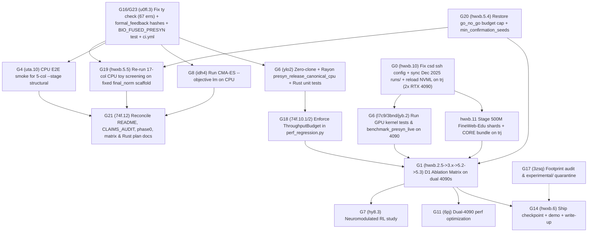

# Bridge Plan — bio_inspired_nanochat

## Follow-up at `8e8ad5c`

Training and held-out evaluation now share a sealed run manifest. The prospective D1 roster
contains 18 dense columns and two screening seeds. It includes both prerequisite controls.
The launcher accounts for physical devices and charges standalone scoring. The eight-cell
CPU rehearsal ran the printed scorer against real checkpoints. Use the prospective protocol
for the next GPU run. The November 22 decision below preserves the findings at its audited
revision. [Current protocol](ablation_matrix.md) · [Follow-up DSR receipts](../results/reality_check_followup_2026-11-22.json)

### Execution order for the remaining research work

- [x] Rebuild the native CPU extension, exercise the public Quick Start, and compare
  repeated native and repeated reference training separately. The cross-backend trained
  logits still miss the registered tolerance. Keep `u0fl.4` open.
  - [x] Repair the macOS arm64 CPU dependency boundary. A fresh Python 3.14.6
    environment loaded the checkout's native ABI 1 extension and PyTorch 2.9.1
    without Triton. All ten Quick Start tests passed using the exact locked wheel
    contents. The Linux dependency still includes Triton.
- [x] Run identical standalone launcher/scorer commands through actual training,
  checkpoint reload and held-out evaluation. Verify candidate isolation in a real
  two-rank optimizer run. These results cover execution and provenance.
- [x] Score the independent 150-step vanilla checkpoint on 384 real-text queries.
  Preserve the zero-coverage result and audit raw entropy, logits and greedy tokens.
  [Scoring result](../results/conformal_abstention_smoke_2026-11-22.json) · [Independent diagnosis](../results/conformal_abstention_smoke_2026-11-22_diagnosis.json)
- [x] Interrupt and restart a bio training job on two physical RTX 4090s. The
  first two comparisons exposed a lost deferred Hebbian update and a dashboard
  that advanced rank 0's RNG. After both fixes the uninterrupted and resumed
  runs agreed on every compared tensor (1,359, 1,359 and 1,351 at steps 1–3),
  the next data and all three validation BPBs. Both ranks rejected the
  missing-shard checkpoint. [Recovery evidence](../results/checkpoint_recovery_2026-11-22.json)
- [ ] Establish admissible D1 rates on staged FineWeb data. The two-card reference
  pilot reached the 91,165,440-parameter model and timed out with zero logged
  updates, checkpoints or scores. The two GPUs incurred 0.40673 GPU-hours
  against a 0.40 allocation, including shutdown. Keep the 36-cell screen on hold.
  - [x] Change only the presynaptic backend in an exploratory run at the same
    geometry. Two updates processed 131,072 positions and produced a complete
    checkpoint in 0.228 GPU-hours. The trainer appended a tracked registry row,
    which invalidated its DSR source-stability receipt. Independent reload
    measured 5.3024 validation BPB on 1,048,576 positions using one GPU. The
    registered-preset scorer rejected the changed backend as designed.
- [ ] Train and score the matched vanilla reference, run admissible registered
  contrasts, then record the statistical decision or the measured budget shortfall.
  Select a final checkpoint only after the absolute quality and reproduction gates.
  - [x] Train the vanilla pilot for 24 optimizer updates on two RTX 4090s.
    After 6,291,456 tokens its independent score was 3.19468 validation BPB.
    The 13 registered timing steps took 72.14 seconds. Applying the frozen
    allowance for startup, saves and variability projected 23,580 seconds against
    a 12,570-second training allocation. The 498,073,600-token run was declined.
    [Checkpoint index, curves, scores and admission rule](../results/vanilla_pilot_2026-11-22.json)
  - [x] Fit the empirical count comparator on the full 498,073,600 training pairs,
    split equally between the two real rank streams. On the same 5,053,422 held-out
    target bytes, unigram scored 2.32499 and smoothed bigram scored 1.81318 bits
    per byte. [Full-exposure count numerators and stream hashes](../results/vanilla_ngram_2026-11-22.json)
  - [x] Fit the same estimators on exactly the neural pilot's 6,291,456 training
    pairs. Both rank-prefix hashes matched the original independent records. On the
    identical held-out bytes, unigram scored 2.33213, bigram 2.23415 and the neural
    pilot 3.19468 bits per byte. At this early checkpoint the bigram used 0.96053
    fewer bits per byte. The 498M-token neural comparison remains open.
    [Matched scores and identities](../results/vanilla_matched_counts_2026-11-23.json)
- [x] Test repetition on the same step-50 checkpoint with presynaptic release enabled
  and disabled. Greedy repeated trigrams fell from 256/352 to 242/352 slots across 16
  documents. Seeded sampling produced zero in both arms. Next-token loss differed by
  −0.0164 nats (paired 95% interval −0.0393 to +0.0070). Calibration chose a zero
  frequency penalty. D1 and independent training-seed replication remain `74f.13`.
- [x] Evaluate the sheaf detector on actual labelled predictions. Eight trained
  variable-binding models got 46/512 held-out answers right. Obstruction AUROC was
  0.5467, cosine 0.5470 and random 0.5609. All adjusted p-values were 1. The
  detector missed the registered superiority threshold.
  - [x] Compare command composition with and without diffusion on eight paired seeds.
    Diffusion solved 52/576 held-out commands and plain attention solved 87/576.
    A zero cycle residual occurred on 32 wrong diffusion outputs. The independent
    verifier reconstructed all 3,456 saved predictions across training budgets.
    [Systematic split and counterexample](theory/sheaf_binding.md#held-out-command-composition)
  - [x] Run actual self-correction on eight trained models and 256 paired requests.
    Correct answers fell from 29 to 14. It rescued none of the 227 initial errors
    and used 3.139× as many backbone calls. [Per-request results](../results/self_correction_binding_2026-11-22.json)
- [ ] Qualify the standing main/nightly DSR gates, reconcile the full Python run,
  and check the final published revision and generated evidence (`u0fl`).
  - [x] Exercise both standing Linux CPU lanes. The main lane caught an optimizer
    argument type error. Nightly passed the validation battery and uncertainty
    suite, then measured a 1.67× cached-decode slowdown against the 1.50× limit.
  - [x] Check the corrected optimizer call with the locked CPU environment.
    The locked type checker passed. The standing workflow's additional
    floating type checker reported 15 diagnostics on newer rules.
  - [x] Time completed CUDA work in the four standard hardware scenarios,
    establish the first device-specific baseline and replay independently.
    All four absolute comparisons passed. The 1.37× training slowdown met
    the 2.00× budget. Cached decode missed its 1.50× budget at 2.43×.
  - [x] The trusted GPU lane ran 9/9 GPU tests and 61/61 reference and Rust tests.
    Against eager synaptic inference the fused primitive was 7.25× faster and the
    cached model 2.00× faster. Against vanilla the synaptic model took 2.29× as
    long to train and 2.34× as long to decode a token. Both relative gates failed.
  - [x] Reproduce four Nsight windows end to end. Both captures measured 124
    launches per cached synaptic token versus 75 for vanilla.
    [Timeline and reproduction command](../TESTING.md#reproduce-the-cuda-timeline)
  - [x] Test one fused cached FP32 RoPE/RMS transform on an RTX 4090. It passed
    all 90 primitive cases and matched 156 token decisions and 36 cache snapshots.
    Across 12 balanced rounds its median speedup was 1.107× (paired bootstrap
    95% interval 0.873–1.264×). The candidate missed the adoption rule.
    [All round timings](../results/profiles/cached_rope_rms_candidate_2026-11-23.json)
  - [x] Measure eager attention at sequence lengths 128 and 1024. Four cases
    completed at each length. The combined five-case CLI now exits nonzero on the
    unsupported Flex case. [Hardware rows](../results/profiles/attention_rtx4090_2026-11-23.json)
  - [x] Measure FP32, TF32, BF16 and FP16 on both real pilot checkpoints.
    All 40 single-update trials, including warmups, had finite gradients and weights.
    TF32 preserved all 64 measured greedy choices. BF16 preserved zero and FP16
    preserved two. No alternative met the registered speed and accuracy criteria.
    [Settings, timings and raw records](../TESTING.md#check-checkpoint-arithmetic-on-an-rtx-4090)
  - [x] Repair the 15 floating type diagnostics and validate the affected callers
    with 340 tests. The full-tree scanner is a separate standing-main gate.
  - [x] Re-run the Linux CPU suite after repairing matrix coverage, the working-memory
    margin, package classification, the structural-NAS artifact and the nested pytest
    interpreter. In the 2,075-test run, 2,063 passed, 11 skipped and one failed.
    The live training comparison measured 5,305 versus 10,864 tokens/s, or 2.05×
    against a 2.00× limit. The 40 targeted regressions passed with their original
    deadlines on the second worker. After the CUDA atlas correction, 2,065 of 2,077
    passed and 11 skipped. The same training budget failed at 4,643 versus
    9,669 tokens/s (2.08×). [DSR run and source fingerprints](../results/reality_check_followup_2026-11-22.json)
  - [x] Close the shared-cache tokenizer deserialization gap. All 18 cases passed,
    including three archived formats. An independently trained checkpoint also
    passed held-out-only scoring through the public CLI.
- [x] Test glial homeostasis × direct metabolic routing with active experts.
  On four paired seeds the mean held-out loss interaction was −0.00010 nats/token
  (95% bootstrap −0.00028 to +0.00005). The original dense experiment's reset
  discarded pending Hebbian updates on all four seeds. Broader interactions
  remain open. [Predictions, routing and paired estimates](../results/mechanism_interaction_moe_2026-11-22.json)
- [x] Replace the continual-learning evaluator's accuracy bonuses and reused training
  probes with disjoint held-out predictions, signed forgetting and matched budgets.
  Preserve the first 36 runs and replay the first failing wake trace. All six sleep
  runs and five of six no-sleep bio runs failed. Gauge and independently implemented
  EWC gave identical final weights on six seeds. Replay retained A but missed the
  acquisition threshold on B. [First study](../results/continual_controls_2026-11-22.json)
  · [First nonfinite trace](../results/continual_first_nonfinite_2026-11-22.json)
  - [x] Bound the molecular response in normalized Hebbian mode and preserve the
    direction of finite trace products that overflow float32. The prior implementation
    failed four of five discriminating cases. The repaired cohort completed 36/36 fits.
    Sleep, no-sleep and vanilla each retained 0/768 A targets after C. Both paired
    sleep-effect intervals were [0, 0]. All 24 unaffected final parameter hashes
    matched. [Complete rerun](../results/continual_controls_bounded_hebbian_2026-11-22.json)
  - [x] Check all mapped runtime tests and compiled theorem identities after the repair.
    The final binding passed 288 tests, with three environment skips, and the compiled
    axiom audit verified all 19 mapped declarations. The statements cover the reduced
    models described in the proof manifest.
  - [ ] A test of holonomy still needs model-derived transport (`0642.7.2.2`).
- [x] Prove two limits under explicit reduced-model assumptions. Four Poisson
  current observations and six live leaky-memory observations respected their
  bounds. A discrete control violated the Poisson bound. [Proofs and curves](theory/impossibility_limits.md)

## November 22, 2026 — decision at `16ce9fe1979c`

**The repository can train and serve a synaptic language model. Whether the synaptic mechanisms
earn their cost on held-out language is still open.** The dual-4090 host, data and kernels exist.
The constraint on the next research dollar is obtaining an interpretable comparison. Running the
current commands verbatim can spend the wrong budget, score a different model or fail to score it
at all. The October plan below is a historical snapshot. This section supersedes its work order.

### What the evidence establishes

| Goal | Evidence at the audited revision | Outstanding acceptance |
|---|---|---|
| 1. Train an actual language model | On the GPU host we found 28 staged shards and four private base-checkpoint directories. The depth-10, width-640 vanilla smoke used 150 × 65,536 = 9,830,400 tokens, seed 1337, context 2048 and reached 2.4480 validation bits/byte. Its commit marker names two optimizer and training shards. [Runbook](epic_runbooks.md) · [Registry](../results/registry.jsonl) | D1 calls for context 1024, a matched full-budget baseline and capability scores. Its published usefulness targets include BPB <1.2, recall and binding >chance+0.20 and NIAH >0.50. Smoke results do not establish these (`hwxb.3.1/.2`). |
| 2. Attribute quality to biology | The matched three-seed WikiText-2 normalization diagnostic measured vanilla 1.9971 and normalized **mechanisms-off** 1.9588. It contains no normalized full-biology arm. A separate 20-step screen measured vanilla 0.956949, off 0.961802 and full 0.961701. All 16 contrasts to vanilla returned null with two seeds and 512 eval tokens/cell. Two vanilla rows lack checkpoint provenance fields. [Diagnostic](../results/scaffold_diagnosis_2026-10-07.json) · [Screen](../results/toy_screening_2026-10-13_summary.csv) | 34 D1 dense screening cells, then an admissible confirmation or a recorded no-go. Equal tokens measure sample efficiency. Report time, capacity and a same-budget comparator for compute efficiency (`hwxb.5`, `74f.6`). |
| 3. Suppress repetition and extend memory | Presynaptic release changes the attention bias during cached decoding. The generation engine passes `train_mode=False`. Hebbian writes are opt-in; five paired chunked-regime seeds gave +0.0104 recall vs a 0.0156 detectable effect. Both chunk-trained arms learned poorly. [Engine](../bio_inspired_nanochat/engine.py) · [Registered recall experiment](../results/hebbian_chunked_regime_2026-10-07_preregistered.json) | Repeat-rate improvement needs generated outputs, matched prompts, decode settings, a frequency-penalty control and held-out quality. Readout of stored information needs a trainable positive control and D1 evidence (`74f.13`, `hwxb.4.4`). |
| 4. Allocate experts where useful | The training controller fires. The credit pilot raised final loss by 0.030–0.050 on 3/3 seeds. In the equal-work eight-seed NAS experiment, fewer dead experts coincided with worse final loss on every seed. The 5 × 2 structural pipeline smoke used two optimizer steps, short of its 100-step event interval. [Pilot](../results/structural_pair_pilot_2026-10-07_credit.json) · [Equal-work study](eval_benchmark_matrix.md) · [Smoke](../results/structural_smoke_2026-10-13.json) | Run the separate M1 fixed-vs-lifecycle control with events, lineage and matched work. Record sparsity-boundary jumps and optimizer resets. The standard chat path has no expert-birth controller (`hwxb.4.3`). |
| 5. Earn the runtime overhead | Clean FP32 RTX 4090 receipt at `0965db1`, 30 trials, 2,048 release keys, shows 6.84× primitive and 1.88× cached-model speed vs eager **synaptic** execution. Separate D1-shaped training profile, two warmups and five measured steps at batch 16/rank and T=1024, gives vanilla 96,181 vs bio 37,429 tok/s, 7.55 vs 14.69 GiB/rank and 100% vs 66.4% reported utilization. That shape misses the 2.0× training budget at 2.57×. [Eligible receipt](../results/presyn_live_rtx4090.json) · [Dual-GPU rows](../results/scale_memory_2x4090_2026-10-14.jsonl) | This benchmark uses random tokens. Its infer rows time full prompts. Measure representative training plus cached decode against vanilla, including dispersion, at the proposed recipe; decode limit 1.5×. Alternative precision, FlexAttention, input pipeline, DDP and CUDA graphs are optimization candidates (`r2d`, `6pj`). |
| 6. Tune useful kinetics | Two private depth-6 GPU checkpoints, 50 steps × 8,192 tokens, seed 42, scored 2.057445 off vs 2.055857 on across different source revisions. The copy proxy gained 0.00078 vs a 0.0021 noise floor. In the distributed LM search the scheduler assigns different candidates per rank while the optimizer factory selects cross-rank gradient collectives. [Registry](../results/registry.jsonl) · [Optimizer](../bio_inspired_nanochat/gpt_synaptic.py) · [CMA runner](../scripts/tune_bio_params.py) | Check serial vs population fitness and final weights, including uneven populations and permutations. Verify each proposed coordinate is active on its model. Defaults vs genuine CMA vs learned kinetics require an independent holdout. Broader searches remain conditional (`0xd.1`, `idh4`, `yw9.6`). |
| 7. Improve decisions under uncertainty | CLI/web can abstain using entropy. The one-layer, ten-seed calibration experiment tied free softmax entropy; the selective demo retained 770/960 predictions and removed two errors. The separate standalone conformal API accepted 32/32 confidently wrong tied predictions with `coverage_guaranteed=True` at α=.05 in a fresh DSR probe. [Calibration artifact](../results/calibration-selective-prediction-86aad7037a51.json) · [Standalone API](../bio_inspired_nanochat/conformal_abstention.py) | Requalify the standalone risk claim and evaluate served error **and coverage** on held-out data. RL sample efficiency and adaptive-compute quality/cost still need matched baselines (`re4e.10`, `hy8.3`, `r00r.16`). |
| 8. Support bounded mathematical claims | Nineteen Lean theorem declarations and axiom-report requests cover reduced models. The model-card policy composes evidence with explicit scope. Tropical affine-region checks, latch hysteresis and a closed-system integrator provide narrower results. The predictive thermodynamics test passed on 0/10 seeds. [Lean scope](../formal/lean/README.md) · [Thermodynamics](theory/stochastic_thermodynamics.md) · [Model-card contract](certified_model_card.md) | No passing production card or joint full-model guarantee. The node-Laplacian minimum cannot distinguish a path from a cycle for H¹, and the detector benchmark pairs interleaved scores with grouped labels. Re-test with identified observations and actual baseline outputs (`0642.8.3.1`, `r00r.5.3`). |
| 9. Deliver working software to another researcher | Installed checkout has a training→checkpoint→generation path. The HF adapter has a pinned tiny-GPT-2 conversion and reload witness. No public zoo weights were found. A clean macOS arm64 CPU-extra resolution on Python 3.14 failed at the Linux-only Triton wheel; the inspected installed wheel supplies the Rust extension. [HF adapter](../results/hf_bio_adapter.json) · [Packaging](../pyproject.toml) · [Zoo](model_zoo.md) | Document the supported installation target, supply weights and tokenizer with hashes and run download→load→greedy sample in a fresh checkout (`hwxb.6.2/.2.1`, `vap.6`). |
| 10. Reproduce results and avoid lost long runs | 215 committed registry rows include 208 CPU and seven CUDA entries (six train and one eval). Several are observations of the same vanilla seed and checkpoint. Vanilla resume has a smoke receipt. [Registry](../results/registry.jsonl) · [Checkpoint contract](scale_up_checkpointing.md) | Interrupt and resume the **active bio state** on two ranks, compare the exact next batch, weights, optimizer state, controllers and loss to an uninterrupted trajectory. Qualify main, nightly and hardware gates through permanent DSR profiles (`hwxb.2.6`, `u0fl.1/.2`). |

### What ran on November 22

DSR launched a two-rank vanilla run through `matrix_launch` on staged real text. One
optimizer step consumed 64 tokens and wrote a complete checkpoint containing both ranks'
optimizer and training shards. The emitted scoring command then failed in argument
parsing. Separately, the real web handler loaded the private depth-6 bio checkpoint under
FastAPI's in-process client. The same prompt produced four greedy tokens and an abstention
when the entropy cutoff was zero. This exercises the handler and checkpoint loader. Public
download, network deployment and useful language quality have their own acceptance criteria.
[Portable DSR evidence](../results/project_reality_check_2026-11-22.json)

The default CPU bio trainer encountered an older installed Rust extension that returned three
values from the detached scan where the audited Python source expected two. The model failed
before its first optimizer update. Disabling the native path completed the two-step control
with the same inputs, and the CLI loaded that new checkpoint and abstained at a zero cutoff.
Across six selected pytest files DSR observed 24 passes, three Rust scan parity failures,
and 13 fixture errors. Nine Quick Start cases shared the native-extension failure. The
four matrix cases shared a second defect. Both vanilla cells trained, then the first
`synaptic_off` cell rejected the trainer's `native_genetics=True` because the preset
disables its prerequisite, `enable_metabolism`. A separate invocation reproduced that
exception. Rebuild and qualify the source-matched wheel (`u0fl.4`) and exercise each
effective matrix config through the real trainer (`hwxb.5.7`). [Training defaults](../scripts/base_train.py) · [Native dispatch](../bio_inspired_nanochat/synaptic.py) · [Mechanism prerequisites](../bio_inspired_nanochat/ablation_registry.py)

### Which closures change a scientific conclusion?

- **Mechanism redundancy.** Twelve named configurations at three steps and three seeds produced
  four distinct per-seed loss vectors. The latch enables Hebbian plasticity, and glial homeostasis
  requires MoE while this harness used a dense model. The unconditional verdict cannot establish
  the interaction. Retain the numbers; repeat with prerequisite-matched controls and paired
  uncertainty before using them to prune a feature (`74f.5`). [Corrected report](mechanism_redundancy_analysis.md)
- **Sheaf detection, forgetting and memory bounds.** A synthetic label-order error mispairs 32
  of 64 observations per default detector seed. Perturbing one linear model does not measure
  holonomy against continual forgetting. Choosing variance above a proposed floor cannot validate
  that floor. The registered endpoints are open again (`0642.8.3.1`, `r00r.5.3`,
  `0642.7.3.1`, `r00r.14`). The registered self-correction task still needs real labelled
  outputs (`re4e.1.3`). [Detector evaluation](../scripts/e2e/sheaf_detector_eval.py) · [Gauge tests](../tests/test_gauge_consolidation.py) · [Limits tests](../tests/test_impossibility_limits.py)
- **Exploratory backends.** With scalar input 100, external activity 0, weight 1 and threshold
  0.1, the sparse prototype returned an error bound of 0.1 while the measured error was 100.
  Its dense linear call still executes. The reversible block computes then discards its parameter
  gradients. Both issues are open (`r00r.13`, `6cb`). Rab/SNARE docking exists off the live MoE
  path; the implemented septin barrier is global. The local router concepts remain proposals
  (`yxq`, `vyh`). [Sparse kernel](../bio_inspired_nanochat/neuromorphic_sparse.py) · [Reversible block](../bio_inspired_nanochat/xpoll.py)

### Experiment and release order

1. **Freeze the question and comparators (`hwxb.5.6`).** Record the descriptive two-seed
   survivor rule before seeing D1. A paired two-sided exact Wilcoxon floor is 0.5 for two
   nonzero pairs, 0.25 for three and 0.03125 for six. With two hypotheses even that last
   best-case raw p misses the first Holm threshold of 0.025. Use the actual hypothesis
   family and independent confirmation seeds or a justified selection-aware design. Compare
   added mechanisms to their prerequisite-only control, leave-one-out to full, and lifecycle
   to fixed MoE. Record parameter counts, token budgets and wall-clock cost. A useful null,
   an underpowered comparison, and a failed run have different interpretations.
2. **Make the normal entry points enforce that design (`hwxb.5.7/.9`).** Use the same manifest
   to admit, launch, resume and score. The printed scorer invokes an unsupported subcommand
   and omits held-out BPB. Stage/seed checkpoint tags can collide. The scorer reconstructs
   the model independently of serving and omits `final_norm` and `logit_softcap`; checking
   biological toggles alone cannot distinguish the fixed and split/merge training recipes.
   Verify data identities and content-disjoint splits. Debit aggregate wall time × device
   count. At the existing 72 GPU-hour cap, 40 hours on two GPUs is a refusal. The example
   with 950 × 524,288 tokens requests 498,073,600 per cell against a 10M-token screen.
   [Launcher](../scripts/matrix_launch.py) · [Scorer](../scripts/eval_matrix.py) · [Admission](../bio_inspired_nanochat/ablation_matrix.py)
3. **Rehearse cheaply, then run the baseline (`hwxb.5.8`, `hwxb.2.6`, `hwxb.3`).**
   The tiny DSR run must execute the printed scorer, identify the exact checkpoint, produce
   finite BPB, reject the wrong checkpoint or spend, and recover from interruption with matching
   state. Retain the actual data/tokenizer hashes and denominators. The baseline must also
   score the absolute usefulness thresholds. [Existing integration test](../tests/test_e2e_matrix_pipeline.py)
4. **Execute the registered study (`hwxb.5.2.1/.2`, `hwxb.5.3`).** Run 17 × 2 dense
   screening cells at ~10M tokens each. Keep the five-column structural study separate.
   Apply the frozen rule, record actual throughput, device-hours and feasibility, and run
   the 100M-token confirmation only when admitted. Preserve all negative outcomes. An
   infeasible budget calls for a new prospective protocol. Dense and M1 results must not
   borrow each other's controls. [Registration and errata](ablation_matrix.md)
5. **Ship the result that survives (`hwxb.6`, `vap.6`).** Report mechanisms that lost,
   tied or exceeded budget alongside any winners. Keep a reproducible baseline available
   even when no biological mechanism qualifies. Public checkpoint acceptance includes a
   versioned download, tokenizer, hashes, exact recipe and a reproducible sample. The
   separate model-card policy needs qualifying evidence from its declared model and scope.

**Would finishing the previous backlog deliver the vision?** It named the baseline, matrix,
checkpoint and write-up. Its literal acceptance criteria could still specify 40
screening cells, confirm on three seeds, score the wrong state, and close CI on a prohibited
execution path. The revised graph connects the new tests to GPU admission and records the
research controls previously missing. Finishing it can yield a trustworthy verdict and a
reproducible release. A positive biological effect remains an empirical question.

The revised graph retains all 511 previous issues, adds seven and reopens nine. Of the
518 issues, 458 are closed, 51 open, eight in progress and one explicitly blocked.
`br dep cycles` reports zero active cycles. The protocol (`hwxb.5.6`), scorer fidelity
(`hwxb.5.9`), native extension (`u0fl.4`) and CMA rank isolation (`0xd.1`) are ready to
pick up independently. The matrix rehearsal depends on the protocol, launcher, scorer
and extension work. [Issue graph](../.beads/issues.jsonl)

---

## Historical audits

- **2026-09-01 (`db544b2`):** Initial Phase 1–2 reality check ("Bio-Nanochat Reality Check").
- **2026-10-07 (`716cacb`…`1b95827`):** Harness defect fixes, toy screening run, scaffold `final_norm` discovery (`8de4abb`), Rust/Triton multi-query causal scan (`85905ad`, `3956cc3`), CMA-ES LM objective (`e9ff9d6`).
- **2026-10-13 (`1b95827`):** Audit of code, tests, artifacts, fleet hardware, docs and Beads at that revision.

The sections below preserve the October assessment and its original task list.

**Rule this plan follows:** A number in a document must cite a committed artifact; a null or negative result is a first-class result; never weaken a gate to land a change; nothing here creates a dashboard, certificate, or matrix that no live code branches on.

---

## Status 2026-10-13 at `1b95827`

| Area / Gap | Ground-Truth Status at `1b95827` | Cited Evidence |
|---|---|---|
| **G0 · Fleet & GPU host `trj`** | **REACHABLE (was misdiagnosed as unreachable); NVML driver reload needed.** From `csd` (`sensedemobox`), `trj` (`threadripperje`, `10.10.10.1` via `mac-mini-max` or Tailscale `100.91.120.17`) is live via `ssh -J mac-mini-max ubuntu@10.10.10.1` and has **2× RTX 4090** (`41:00.0`, `42:00.0`) + `/data/projects/bio_inspired_nanochat` cloned at `1b95827` + intact Dec 2025 `runs/` artifacts. `nvidia-smi` on `trj` currently fails with `Driver/library version mismatch (NVML 595.99 vs kernel 595.91.07)` held by 4 `gunicorn` processes (`bulk_youtube_transcript_optimizer`). Also `ts2` (`thinkstation2`) is directly reachable (`ssh ts2`) with a working GTX 1070. | Live SSH probe `csd -> mac-mini-max -> trj`; `hwxb.10` |
| **G1 · Toy screening vs `final_norm` fix (`8de4abb`)** | **STALE HEADLINE NUMBERS IN DOCS.** `results/toy_screening_2026-10-07_verdict.md` (`vanilla` 1.958, `synaptic_off` 2.028 [+0.069], `bio_all` 2.038 [+0.080] val bpb) was run on `be7344f` **before** `716cacb` (which turned `enable_hebbian` off by default and moved MoE mechanisms to `structural_columns()`) and **before** `8de4abb` (which added the missing final RMSNorm before `lm_head` in `GPTSynaptic`). In `results/scaffold_diagnosis_2026-10-07.json`, `final_norm=True` moved `synaptic_off` from **+0.087 bpb behind `vanilla` to −0.0383 bpb ahead of `vanilla` on all 3 seeds** (`1.9625/1.9513/1.9626` vs `2.0097/1.9969/1.9846`). Yet the 17-column toy screening was never re-run at `1b95827`, and `README.md`, `CLAIMS_AUDIT.md`, and this file still cite the pre-`8de4abb` unnormalized deficit. | `8de4abb`, `results/scaffold_diagnosis_2026-10-07.json` vs `results/toy_screening_2026-10-07_verdict.md` |
| **G2 · Online fast weights (`enable_hebbian`)** | **DECIDED (negative at toy scale).** Pre-registered chunked-regime benchmark (`chunk_len=8`) showed `hebbian_on == hebbian_off` on associative recall (`0.225` vs `0.225`) and worse validation loss (`3.671` vs `3.591`, all 5 seeds positive) at 0.34× throughput. Demoted to opt-in (`enable_hebbian=False`, `bdnf_scale=1.0` gated behind `enable_hebbian`); `add_hebbian` and `add_bdnf` are now distinct `add_one_in` columns. | `716cacb`, `results/hebbian_chunked_regime_2026-10-07_preregistered.json`, `docs/online_learning_status.md` |
| **G3 · Evaluation determinism** | **WORKING.** `GPTSynaptic.forward` defaults `train_mode=None -> self.training` (`5cb1a90`). All 3 CPU benchmarks (`fast_weight_comparison`, `structural_nas_evaluation`, `cmaes_phase1_rerun_2026-10-07`) were re-run under the deterministic regime (`1c8ce91`, `e9ff9d6`). | `5cb1a90`, `1c8ce91`, `tests/test_eval_determinism.py` |
| **G4 · Structural lifecycle (`uta`)** | **WIRED & MEASURED AT TOY SCALE.** NeuroScore EMA bug fixed (`aeaf162`); `sm_health_mode="credit"` fires (`3–6` splits, `14–15` merges, `2–8` resets over 120 steps) with `+0.030…+0.050` loss cost at 2L/64d (`results/structural_pair_pilot_2026-10-07_credit.json`). `structural_columns()` now has 5 MoE columns (`moe_fixed`, `moe_splitmerge`, `moe_no_metabolism`, `moe_no_genome`, `moe_add_glial_homeostasis`). E2E subprocess test of `--stage structural` remains open in `uta.10`. | `aeaf162`, `716cacb`, `results/structural_pair_pilot_2026-10-07_credit.json` |
| **G6 · Presyn recurrence & kernels** | **CPU SCAN LANDED; GPU ACCEPTANCE OPEN.** Detached recurrence no longer builds autograd graphs (`b5325a1`); Rust `presyn_detached_scan_cpu` (`85905ad`, `BIO_FUSED_PRESYN=1`) cuts 2L/128d `seq=256` step time `1633 ms -> 925 ms` (1.77×); Triton `presyn_detached_scan_kernel` (`3956cc3`) passes on `TRITON_INTERPRET=1`. Real CUDA execution on `trj` (`l7c9`, `3bnd`, `jyb.2`, `jyb.3`) awaits NVML reload. | `b5325a1`, `85905ad`, `3956cc3`, `tests/test_presyn_scan_kernel.py` |
| **G8 · CMA-ES hyperparameter tuning (`idh4`)** | **PARTIAL.** Copy-task proxy re-run confirmed No-go (`results/cmaes_phase1_rerun_2026-10-07.json`: all candidates score `6.950 ≈ ln(1024)`). Held-out language-model objective (`--objective lm`, `LMTask` on real shards with `setup_optimizers()`) landed in `e9ff9d6`, but the actual `--objective lm` optimization run has not yet been executed and committed. | `e9ff9d6`, `results/cmaes_phase1_rerun_2026-10-07.json`, `scripts/tune_bio_params.py` |
| **G16 / G23 · Code quality & CI gates (`ty`, `formal_feedback`)** | **REGRESSED AT HEAD (`1b95827`).** Despite `CHANGELOG.md` claiming `ty check` is clean at `716cacb`, `uv run --no-sync ty check` currently **fails with 67 diagnostics** (`tests/test_ablation_matrix.py` lines 112–113, 222–225 from `716cacb`; `tests/test_tune_bio_params.py` lines 166–168 from `e9ff9d6`). Furthermore, `scripts.formal_feedback` and `tests/test_formal_feedback.py` **fail** because `formal/lean/proof_artifacts.json` has stale SHA-256 hashes for 4 files modified in `716cacb`. And setting `BIO_FUSED_PRESYN=1` in the shell breaks `tests/test_ablation_registry.py` because `SynapticConfig.native_presyn` reads `BIO_FUSED_PRESYN` at import time. | `uv run --no-sync ty check`, `uv run --no-sync python -m scripts.formal_feedback` |
| **G20 · Confirmation-pass statistical power deadlock** | **SELF-BLOCKING SPEC BUG.** `ablation_matrix.go_no_go()` (`bio_inspired_nanochat/ablation_matrix.py:414-431`) refuses to proceed whenever `2 * 0.5^n * m > 0.05` (exact two-sided Wilcoxon floor under Holm correction). Yet `CONFIRMATION_SEEDS` (`ablation_matrix.py:85`), `docs/ablation_matrix.md`, and `hwxb.5.2.2` still pin `n = 3` seeds (`best_case_p = 0.25 > 0.05`), so `go_no_go()` **unconditionally returns `proceed=False` ("INFEASIBLE design")** and `eval_stats.compare_matrix` forces every 3-seed verdict to `"null"`. | `bio_inspired_nanochat/ablation_matrix.py:85,414-431`, `tests/test_ablation_matrix.py:186-195` |

---

## 1. Gap Register (2026-10-13 Audit)

Severity measures impact on the project's core scientific & engineering promises. "Beads?" indicates whether existing open beads in `.beads/` completely cover the gap.

| # | Gap | Vision Items | Status at `1b95827` | Severity | Beads? | Size |
|---|---|---|---|---|---|---|
| **G0** | **GPU host `trj` access & NVML driver mismatch:** `trj` (2× RTX 4090) IS reachable via `mac-mini-max` (`10.10.10.1` / Tailscale `100.91.120.17`), but `csd`'s `~/.ssh/config` points `trj` to `localhost` and `trj` has an NVML 595.99 vs kernel 595.91.07 mismatch held by 4 `gunicorn` PIDs. | 9, 10, 12, 13, 19 | **BLOCKED ON DRIVER RELOAD** | Critical | Partial (`hwxb.10` had wrong diagnosis) | S |
| **G1** | **Headline bio-vs-vanilla experiment at D1 scale (17 dense + 5 MoE columns):** Harness & launcher ready; zero GPU runs executed yet. | 12, 13, 19 | **NOT STARTED (GPU)** | Critical | Yes (`hwxb.2.5→2.6→3.x→5.2→5.3→6.x`, `4fw`, `gzm`) | XL |
| **G19** | **Post-`8de4abb` (`final_norm=True`) 17-column toy screening & doc sync:** Headline CPU numbers in `README.md`, `CLAIMS_AUDIT.md`, and `results/toy_screening_2026-10-07_verdict.md` come from pre-`8de4abb` (`final_norm` missing) and pre-`716cacb` (`enable_hebbian=True`). `scaffold_diagnosis_2026-10-07.json` proved `synaptic_off` beats `vanilla` by `-0.0383` bpb once normalized, but the 17-column screening was never re-run. | 1, 12, 21 | **STALE ARTIFACT & DOCS** | Critical | Was NO BEAD → now `hwxb.5.5` | M |
| **G20** | **Confirmation-pass statistical power deadlock (`CONFIRMATION_SEEDS` vs `go_no_go`):** `CONFIRMATION_SEEDS` has 3 seeds, where exact Wilcoxon has floor `p = 0.25 > 0.05`. `go_no_go()` unconditionally rejects `n = 3` as `"INFEASIBLE design"`, and `eval_stats.compare_matrix` forces all 3-seed runs to `"null"`. | 12, 16 | **BROKEN CONTRACT** | Critical | Was NO BEAD → now `hwxb.5.4` | S |
| **G16 / G23** | **Regressed CI gates at HEAD (`ty check`, `formal_feedback`, `BIO_FUSED_PRESYN` env collision, `ci.yml` `--no-sync`):** `ty check` fails with 67 diagnostics; `formal_feedback` fails on 4 stale SHA-256 hashes in `formal/lean/proof_artifacts.json`; `BIO_FUSED_PRESYN=1` breaks `test_ablation_registry.py`; `ci.yml` `build-wheel` lacks `--no-sync`. | 21, 23 | **REGRESSED** | High | Was NO BEAD → now `u0fl.3` | S |
| **G2** | **Online fast-weight efficacy (`enable_hebbian`):** Proven null/negative on 5-seed chunked associative recall (`results/hebbian_chunked_regime_2026-10-07_preregistered.json`); now default-OFF (`add_hebbian`/`add_bdnf`). Scale-up check (`hwxb.4.4`) remains open for GPU. | 3 | **DECIDED (CPU NULL) / GPU OPEN** | Major | Yes (`hwxb.4.4`) | M |
| **G3** | **Evaluation determinism (`GPTSynaptic.forward` default `train_mode=None`):** Fixed in `5cb1a90`; CPU artifacts re-run with `measurement_regime` metadata in `1c8ce91`. | 1, 2, 11, 12 | **WORKING (CLOSED)** | — | Closed (`5cb1a90`, `1c8ce91`) | — |
| **G4** | **Structural lifecycle (`uta`):** Credit health mode (`sm_health_mode="credit"`) fires at toy scale (`results/structural_pair_pilot_2026-10-07_credit.json`) and is wired into `structural_columns()` (now 5 MoE columns). Subprocess E2E smoke (`uta.10` step 3) and GPU scale-up (`hwxb.4.3`, `uta.2`) remain open. | 5, 6 | **PARTIAL** | Major | Yes (`uta.10`, `hwxb.4.3`, `uta.2`) | M |
| **G5** | **End-to-end subprocess gate for training scripts:** `tests/test_e2e_quick_start.py` and `tests/test_e2e_matrix_pipeline.py` landed. | 14, 23 | **WORKING (CLOSED)** | — | Closed (`5a27e16`) | — |
| **G6** | **Kernels & exact causal recurrence:** Detached scan (`b5325a1`), Rust CPU scan (`85905ad`), and Triton scan (`3956cc3`) landed on CPU/interpreter. Real RTX 4090 execution (`l7c9`, `3bnd`, `jyb.2`, `jyb.3`, `jyb.10`) and Rust decode row-parallelism (`ylo2`) remain open. | 9, 10 | **PARTIAL (CPU DONE, GPU OPEN)** | Major | Yes (`l7c9`, `3bnd`, `jyb.2`, `jyb.3`, `jyb.10`, `ylo2`) | L |
| **G7** | **Neuromodulation efficacy & RL study:** `add_neuromod` is in the 17-column screening matrix; `hwxb.4.2` and `hy8.3` (RL study) await GPU. | 7 | **UNPROVEN (GPU)** | Major | Yes (`hwxb.4.2`, `hy8.3`) | L |
| **G8** | **CMA-ES on a language-model objective (`idh4`):** Copy-task proxy re-run confirmed No-go (`results/cmaes_phase1_rerun_2026-10-07.json`). `--objective lm` implemented in `scripts/tune_bio_params.py` (`e9ff9d6`), but the `--objective lm` optimization run itself has not been executed/committed. | 11 | **PARTIAL** | Major | Yes (`idh4`) | M |
| **G9** | **Roadmap features evidence mapping:** Resolved in `README.md` §Roadmap (`74f.9`). | 18 | **WORKING (CLOSED)** | — | Closed (`74f.9`) | — |
| **G10** | **Selective decoding / calibrated abstention in serving:** Wired into `Engine.generate(selective=...)`, `chat_cli --selective`, and `chat_web` (`wmel.1`, `wmel.2`). | 8 | **WORKING (CLOSED)** | — | Closed (`wmel`) | — |
| **G11** | **Dual-4090 performance program:** All 9 beads (`6pj`, `j9i`, `2fh`, `4nk`, `5rh`, `94r`, `h4j`, `r2d`, `vwl`) open and awaiting `trj` GPU availability. | 13 | **NOT STARTED (GPU)** | Major | Yes (`6pj` children) | XL |
| **G14** | **Ship a usable checkpoint, inference demo & write-up:** Open under `hwxb.6.1–6.3`, `vap.6`. | 19, 20 | **NOT STARTED (GPU)** | Critical | Yes (`hwxb.6.x`, `vap.6`) | L |
| **G15** | **CI verified green on GitHub / self-hosted runner:** Tracked by `u0fl`, `u0fl.1`, `u0fl.2`. Currently blocked by G16/G23 regressions on `main` (`ty check` and `formal_feedback` fail). | 23 | **REGRESSED / UNVERIFIED** | Major | Partial (`u0fl` + new G16/G23 bead) | S |
| **G17** | **Package footprint hygiene:** 94 top-level modules in `bio_inspired_nanochat/`; 46 reachable from `scripts/` (only 15 from core `gpt`/`gpt_synaptic`/`synaptic`/`synaptic_splitmerge`), 48 unreachable from `scripts/` (test-only/standalone). Tracked by `3zsq`, `3zsq.1`, `3zsq.2` (no file deletion without written permission per Rule 1). | 22 | **OPEN DEBT** | Minor | Yes (`3zsq`, `3zsq.1`, `3zsq.2`) | M |
| **G18** | **Throughput budget & `perf_regression` gate:** Tracked by `74f.10`, `74f.10.1`, `74f.10.2`. | 9, 13 | **IN PROGRESS** | Major | Yes (`74f.10.1`, `74f.10.2`) | M |
| **G21** | **Cross-document & bead specification drift:** (1) `docs/scale_up_phase0_decisions.md` §1/§3.2 says `working_memory_suite` is PRIMARY and `val_bpb` is secondary, contradicting `docs/ablation_matrix.md` and `ablation_matrix.py:455` (`DECISION_PRIMARY_METRIC = "val_bpb"`). (2) `docs/ablation_matrix.md` §4 still says `13 columns × 3 seeds` while §2 says `17`. (3) `hwxb.5.2.1` says `20 columns` instead of `17 dense + 5 structural`. (4) `ablation_matrix.py:44` docstring says `neuromod` is not registered when it is. (5) `docs/eval_benchmark_matrix.md:151` says `base_train.py` lacks CLI overrides for `SynapticConfig`. (6) `TESTING.md:138` claims 27 Rust unit tests in `rust_src` when `cargo test` runs `0 tests`. (7) `PLAN_TO_OPTIMIZE_KEY_HOTSPOTS_USING_RUST_PYO3.md` is a byte-for-byte duplicate of `PLAN_TO_OPTIMIZE_KEY_HOTSPOTS_USING_TRITON.md`. (8) `README.md` L631 still says `96-parameter SynapticConfig` (vs 109) and L191 claims Dec 2025 `runs/` are gone when they exist on `trj`. | 12, 21, 22 | **DRIFTED** | Medium | Was NO BEAD → now `74f.12` | S |

---

## 2. Detailed Resolutions for Active & Newly Discovered Gaps

### G16 / G23 · Restore Green Code-Quality & Formal-Proof Gates on `main` — REGRESSED → WORKING *(Priority 0: do immediately on CPU)*

**Current state at `1b95827`.**
1. `uv run --no-sync ty check` fails with **67 diagnostics**:
   - `tests/test_ablation_matrix.py` lines 112–113 and 222–225 (7 errors): `build_syn_cfg()` returns `SynapticConfig | None`, and the assertions added in `716cacb` access `.enable_metabolism`, `.glial_homeostasis`, `.enable_hebbian`, `.bdnf_scale` without narrowing `None`.
   - `tests/test_tune_bio_params.py` lines 166–168 (60 errors): `kwargs = dict(...)` added in `e9ff9d6` widens the value type to an untyped union, failing `ty` checking on all 20 keyword parameters of `evaluate_candidate_detailed(...)`.
2. `uv run --no-sync python -m scripts.formal_feedback` and `pytest tests/test_formal_feedback.py` fail with `FormalFeedbackError: stale runtime hash` for 4 files modified in `716cacb`:
   - `bio_inspired_nanochat/ablation_matrix.py` (`4b6420f488a7...` → `301fcb4b7b6f...`)
   - `bio_inspired_nanochat/ablation_registry.py` (`62ff0747f7c1...` → `7dc100e1d547...`)
   - `tests/test_ablation_matrix.py` (`399cbc1f3d33...` → `e5a5bb68625f...`)
   - `tests/test_scaleup_ablation_e2e.py` (`9c9056c181cc...` → `f6f50fcd23ce...`)
3. Setting `BIO_FUSED_PRESYN=1` in the shell environment causes `tests/test_ablation_registry.py::test_registry_defaults_match_synaptic_config` and `test_native_presyn_is_a_default_off_backend_valid_in_every_column` to fail because `SynapticConfig.native_presyn` evaluates `decouple_config("BIO_FUSED_PRESYN", default=False, cast=bool)` at class definition time.
4. `.github/workflows/ci.yml` line 211 (`build-wheel`) runs `uv run maturin build --release` without `--no-sync`, causing `uv` to re-resolve and download CUDA PyTorch mid-job after `uv sync --extra cpu --dev`.

**Target state.**
- Fix the type annotations in `tests/test_ablation_matrix.py` and `tests/test_tune_bio_params.py` so `uv run --no-sync ty check` exits 0 with 0 diagnostics.
- Append a new proof-preserving runtime-hash refresh record in `formal/lean/proof_artifacts.json` (after fixing `tests/test_ablation_matrix.py`) so `uv run --no-sync python -m scripts.formal_feedback --run-tests` and `pytest tests/test_formal_feedback.py` exit 0.
- Make `tests/test_ablation_registry.py` resilient to `BIO_FUSED_PRESYN=1` in the outer environment (or read `BIO_FUSED_PRESYN` cleanly) so running the test suite with `BIO_FUSED_PRESYN=1` passes 100%.
- Add `--no-sync` to `uv run --no-sync maturin build --release` in `.github/workflows/ci.yml`.

**Success criteria.**
- [ ] `uv run --no-sync ruff check` exits 0.
- [ ] `uv run --no-sync ty check` exits 0.
- [ ] `uv run --no-sync python -m scripts.formal_feedback --run-tests` exits 0.
- [ ] `BIO_FUSED_PRESYN=1 OMP_NUM_THREADS=1 uv run --no-sync pytest tests/test_ablation_registry.py tests/test_ablation_matrix.py tests/test_tune_bio_params.py tests/test_formal_feedback.py` exits 0.

---

### G0 · Unblock Dual-4090 GPU Host `trj` (`hwxb.10`) — MISDIAGNOSED → READY

**Current state.**
- `trj` (`threadripperje`) is NOT missing or offline. It is reachable from `csd` (`sensedemobox`) through `mac-mini-max` (`ssh -J mac-mini-max ubuntu@10.10.10.1` or Tailscale `100.91.120.17`).
- On `csd`, `~/.ssh/config` currently has a broken stub (`Host trj` -> `HostName localhost`) and lacks `trj_ed25519` (which lives on `mac-mini-max:~/.ssh/trj_ed25519`).
- On `trj`, `/data/projects/bio_inspired_nanochat` is already cloned at `1b95827` (`main`), and two RTX 4090s are attached at PCIe `41:00.0` and `42:00.0`.
- `nvidia-smi` on `trj` currently fails with `Failed to initialize NVML: Driver/library version mismatch (NVML library version: 595.99)` vs loaded kernel module `595.91.07` (`/proc/driver/nvidia/version`), held open by 4 `gunicorn` processes from `/data/projects/bulk_youtube_transcript_optimizer` (PIDs 7365, 13148, 13154, 3020335).
- Additionally, `ts2` (`thinkstation2`, GTX 1070, driver 590.48.01) is directly reachable via `ssh ts2` right now.

**Target state.**
1. Update `~/.ssh/config` on `csd` so `Host trj threadripperje` uses `HostName 10.10.10.1` with `ProxyJump mac-mini-max` (and copy `trj_ed25519` to `csd:~/.ssh/`), enabling direct `ssh trj`.
2. On `trj`, coordinate a brief restart of the `gunicorn` processes (or reboot `trj` / `sudo rmmod nvidia_uvm nvidia_drm nvidia_modeset nvidia && sudo modprobe nvidia_uvm`) so kernel module `595.99` matches userland NVML `595.99`.
3. On `trj:/data/projects/bio_inspired_nanochat`, run `uv sync --extra cuda --dev && uv run --no-sync maturin develop --release --manifest-path rust_src/Cargo.toml` and `uv run --no-sync pytest -m gpu -v`.
4. Copy the surviving December 2025 artifacts (`runs/ca_init_microbench/20251218_054731/`, `runs/cmaes_phase1_10d_*`, `runs/eval_matrix/`) or their summary metadata into tracked `results/` if needed, and correct the false "runs/ is gone" statement in `README.md`, `CLAIMS_AUDIT.md`, and `docs/ca_init_decision.md`.

**Success criteria.**
- [ ] `ssh trj nvidia-smi -L` lists two `NVIDIA GeForce RTX 4090` GPUs.
- [ ] `ssh trj "cd /data/projects/bio_inspired_nanochat && uv run --no-sync pytest -m gpu -v"` passes with 0 failures.
- [ ] `hwxb.10` closed with recorded driver/CUDA/PyTorch versions and GPU test output, unblocking all 20+ downstream GPU beads.

---

### G19 · Re-run the 17-Column Toy Screening on the Fixed (`final_norm=True`, `enable_hebbian=False`) Scaffold & Sync Docs — STALE → CURRENT

**Current state.**
- `results/toy_screening_2026-10-07_verdict.md` and `results/toy_screening_2026-10-07_summary.csv` were generated at `be7344f` (19 columns), before `716cacb` (`enable_hebbian=False`, MoE columns moved to `structural_columns()`) and before `8de4abb` (`final_norm=True` on `GPTSynaptic`).
- In that pre-fix run, `GPTSynaptic` lacked the final RMSNorm before `lm_head`, causing `synaptic_off` to lose to `vanilla` by `+0.069` val bpb (`2.028` vs `1.958`), and `enable_hebbian=True` degraded `bio_all` (`2.038`) and every `bio_no_*` column.
- Commit `8de4abb` proved in `results/scaffold_diagnosis_2026-10-07.json` that with `final_norm=True`, `synaptic_off` beats `vanilla` on all 3 seeds by `-0.0383` val bpb (`1.9588` vs `1.9971` mean).
- Yet `README.md` (L25, L149), `CLAIMS_AUDIT.md` (L13, L77), and `results/toy_screening_2026-10-07_verdict.md` still report the broken pre-`8de4abb` numbers (`+0.069` / `+0.080` deficit), and `CHANGELOG.md` (L45) misquotes `bio_no_bdnf` from that pre-fix CSV as `add_hebbian`/`add_bdnf`.

**Target state.**
- Execute the 17-column dense toy screening (`am.screening_columns()`: 3 anchors + 4 `leave_one_out` + 10 `add_one_in`) × 3 seeds (`1337, 1338, 1339`) at HEAD (`final_norm=True`, `enable_hebbian=False`, `BIO_FUSED_PRESYN=1`) on the same 2L/128d WikiText-2 300-step protocol.
- Commit the updated summary CSV, verdict JSON, and verdict markdown in `results/`.
- Update `README.md`, `CLAIMS_AUDIT.md`, `CHANGELOG.md`, and `docs/bridge_plan.md` to cite the post-`8de4abb` 17-column artifact alongside the pre-`8de4abb` scaffold diagnosis.

**Success criteria.**
- [ ] All 51 cells (`17 columns × 3 seeds`) complete with `status == "ok"` and `recipe_source == "base_train_checkpoint"`.
- [ ] `synaptic_off` vs `vanilla` reflects the `final_norm=True` scaffold, and `add_hebbian` vs `add_bdnf` are measured as distinct columns.
- [ ] Every headline toy-screening number in `README.md` and `CLAIMS_AUDIT.md` matches the committed post-`8de4abb` artifact.

---

### G20 · Resolve Confirmation-Pass Statistical Power Deadlock & Restore Deleted Budget Cap in `go_no_go()` — DEADLOCKED → FEASIBLE

**Current state.**
- `eval_stats.compare_matrix()` (`bio_inspired_nanochat/eval_stats.py:468-474`) requires **both** Holm-adjusted paired t-test `p <= alpha` **and** Holm-adjusted exact two-sided Wilcoxon signed-rank `p <= alpha` (`alpha = 0.05`) to declare `supported_gain` or `supported_regression`.
- For `n` matched seeds, the exact two-sided Wilcoxon p-value has a hard mathematical floor of `2 * 0.5^n`. For `n = 3` (`CONFIRMATION_SEEDS = (1337, 1338, 1339)`), the minimum possible Wilcoxon p-value is `0.25 > 0.05`.
- Worse, commit `ea54808` **accidentally deleted `if hours > cap_gpu_hours:`** from `ablation_matrix.go_no_go()` (`bio_inspired_nanochat/ablation_matrix.py:414-431`) when adding the `best_case_p > CONFIRMATION_ALPHA` check! `test_go_no_go_blocks_when_over_the_cap` only passed by coincidence because `n=3` triggered the `INFEASIBLE` Wilcoxon branch while `hours` happened to exceed `cap_gpu_hours`; for `n >= 6` seeds, `go_no_go()` currently returns `proceed=True` even when `hours = 66666.7 > cap_gpu_hours = 1.0`!
- Meanwhile, `scripts/matrix_launch.py --stage confirmation` defaults to `am.CONFIRMATION_SEEDS` (`n=3`), which is rejected by `go_no_go()` as `INFEASIBLE`.

**Target state.**
1. **Restore `if hours > cap_gpu_hours:` in `ablation_matrix.go_no_go()`** so over-budget confirmation passes are blocked for any seed count `n`, and add a regression test with `n=6` seeds over the GPU-hour cap.
2. **Add `min_confirmation_seeds(n_survivors: int = 1, alpha: float = CONFIRMATION_ALPHA) -> tuple[int, ...]` and `FEASIBLE_CONFIRMATION_SEEDS`** (`n=6`: `(1337, 1338, 1339, 1340, 1341, 1342)`) to `bio_inspired_nanochat/ablation_matrix.py` while keeping `CONFIRMATION_SEEDS = (1337, 1338, 1339)` for backwards compatibility with `test_go_no_go_blocks_statistically_infeasible_design`.
3. **Wire `min_confirmation_seeds(len(survivors))` into `scripts/matrix_launch.py --stage confirmation`** when `--seeds` is not explicitly overridden (or warn/upgrade when `len(seeds) < min_n`), so `--stage confirmation` automatically emits a statistically powered confirmation schedule that passes `go_no_go()` when within `cap_gpu_hours`.

**Success criteria.**
- [ ] `go_no_go()` blocks when `hours > cap_gpu_hours` for both `n=3` and `n=6` seeds.
- [ ] `min_confirmation_seeds(len(survivors))` produces the exact minimum seed tuple (`n = ceil(log2(2m/alpha))`) starting at `1337`, and `go_no_go(survivors, tok_per_sec=50_000.0, seeds=min_confirmation_seeds(len(survivors)))` returns `proceed == True`.
- [ ] `scripts/matrix_launch.py --stage confirmation --survivors bio_no_presyn` uses `min_confirmation_seeds` by default and passes all unit tests.

---

### G4 & `uta.10` · Finish CPU E2E Smoke of the 5-Column Structural Stage — PARTIAL → WORKING

**Current state.**
- Steps 1 and 2 of `uta.10` (`STRUCTURAL_TRAIN_OVERRIDES` using `sm_health_mode="credit"`, `docs/ablation_matrix.md` §6 updated with `results/structural_pair_pilot_2026-10-07_credit.json`, `tests/test_matrix_launch.py` updated, plus `moe_no_metabolism`, `moe_no_genome`, `moe_add_glial_homeostasis` added to `structural_columns()`) are already in `main`.
- Step 3 of `uta.10` (running `matrix_launch --stage structural` -> `base_train` -> `eval_matrix` -> `eval_stats` end-to-end on a tiny CPU recipe to prove MoE checkpoints round-trip through `eval_matrix`'s bio-flag and MoE architecture reconstruction) has not been executed yet.

**Target state.**
- Run and test the structural stage (`moe_fixed`, `moe_splitmerge`, `moe_no_metabolism`, `moe_no_genome`, `moe_add_glial_homeostasis`) end-to-end through `matrix_launch --stage structural --execute` -> `eval_matrix` -> `eval_stats`, commit the CPU structural smoke artifact in `results/`, add an automated E2E test in `tests/test_e2e_matrix_pipeline.py`, and close `uta.10`.

**Success criteria.**
- [ ] `eval_matrix` loads all structural stage checkpoints from `base_train`, reconstructs `use_moe=True`, populates `moe_gini` and `dead_expert_frac` (non-null), and `eval_stats` pairs structural arms against `moe_fixed`.

---

### G8 & `idh4` · Execute CMA-ES Phase 1 with `--objective lm` on CPU — PARTIAL → MEASURED

**Current state.**
- `results/cmaes_phase1_rerun_2026-10-07.json` re-ran the synthetic copy-task proxy under deterministic eval and proved why it failed (`6.950 ≈ ln(1024)` uniform loss).
- Commit `e9ff9d6` added `--objective lm` (`LMTask` on real parquet shards with `setup_optimizers()` and held-out `val_bpb`) to `scripts/tune_bio_params.py`, and `test_lm_objective_learns_real_structure_deterministically` proved that 40 steps lower held-out bpb by >1.0 bpb.
- However, no CMA-ES optimization run using `--objective lm` has been executed and committed to `results/`.

**Target state.**
- Run `scripts.tune_bio_params optimize --objective lm` on CPU (with `BIO_FUSED_PRESYN=1`, fixed FineWeb/WikiText shards, readiness gate enabled), commit the resulting JSON artifact under `results/cmaes_phase1_lm_2026-10-*.json`, and update `PLAN_TO_USE_CMAES_...md` and `README.md` §Systematic Optimization.

**Success criteria.**
- [ ] Committed `results/cmaes_phase1_lm_*.json` reporting baseline bpb, best bpb, seed-noise floor, and Go/No-go verdict.

---

### G6 & `ylo2` · Zero-Clone + Rayon Row-Parallel Optimization of `presyn_release_canonical_cpu` + Native Rust Unit Tests — SLOW AT LONG CONTEXT → >2× FASTER ACROSS 512–4,096 KEYS

**Current state.**
- `rust_src/src/presyn.rs::presyn_detached_scan_cpu` (multi-query scan) already uses Rayon `par_for_each` over `(batch, head)` rows and updates a contiguous `(7, n_rows, key_count)` slab in place.
- By contrast, `rust_src/src/presyn.rs::presyn_release_canonical_cpu` (single-query `Tq=1` decode) still runs sequentially over `for b in 0..batch { for h in 0..heads`, copies 8 `(B, H, T_key)` arrays + `endo_delay` arrays via `.to_owned()`, `.clone()`s 7 more `previous_*` `(B, H, T_key)` arrays (even though step 2 updates each key `0..key_count` independently!), and allocates 3 full `(B, H, T_key)` scratch arrays (`released_by_key`, `drive_by_key`, `accessed`) on every token. At `T_key = 4096`, those 21 heap allocations/clones make Rust decode `0.75×` slower than PyTorch (`1.81 ms` vs `1.36 ms`).
- Furthermore, `cargo test --manifest-path rust_src/Cargo.toml --no-default-features` runs `0 tests` because `rust_src` has no `#[cfg(test)]` module.

**Target state.**
1. Eliminate the 7 redundant `previous_*` 3D array clones and the 3 full-`(B, H, T_key)` scratch allocations in `presyn_release_canonical_cpu`, parallelize over `(batch, head)` rows with Rayon (with contiguous slice iteration for SIMD auto-vectorization), and avoid copying `AMP` when unchanged.
2. Add native `#[cfg(test)]` Rust unit tests in `rust_src/src/presyn.rs` and `rust_src/src/moe.rs` so `cargo test --manifest-path rust_src/Cargo.toml --no-default-features` tests the Rust math directly.
3. Benchmark `presyn_release_canonical_cpu` vs PyTorch across `512`, `1,024`, `2,048`, and `4,096` keys, commit `results/presyn_rust_decode_bench_2026-10-13.json`, and close `bio_inspired_nanochat-ylo2`.

**Success criteria.**
- [ ] `tests/test_presyn_rust_dispatch.py` and `tests/test_presyn_rust_parity.py` pass with exact float32 parity.
- [ ] `cargo test --manifest-path rust_src/Cargo.toml --no-default-features` executes and passes `>= 10` native Rust unit tests.
- [ ] Committed benchmark shows `>= 2.0×` speedup over PyTorch at `2,048` and `4,096` keys.

---

### G18 & `74f.10` · Enforce Bio/Vanilla Throughput Budget in `perf_regression.py` — DRIFT-ONLY → BUDGET-GATED

**Current state.**
- `README.md` §Performance and `docs/ablation_matrix.md` §3 declare the accepted throughput budget: `bio_all` training tok/s `>= 1/2.0` of param-matched `vanilla` (`train_ratio_max = 2.0`) and `Tq=1` cached decode latency `<= 1.5×` `vanilla` (`decode_ratio_max = 1.5`).
- However, `bio_inspired_nanochat/perf_regression.py` only compares each benchmark against its own historical baseline (`evaluate_gates`), never comparing synaptic vs standard throughput/latency ratios against the declared budget.

**Target state.**
- Add `ThroughputBudget(train_ratio_max: float = 2.0, decode_ratio_max: float = 1.5)` and `evaluate_budget_gates(results, budget)` to `bio_inspired_nanochat/perf_regression.py`.
- Add unit tests in `tests/test_perf_regression.py` including a planted `3×` slowdown negative test that fails the gate and a positive test within budget, and document the gate in `TESTING.md`.

---

### G21 · Reconcile Cross-Document & Bead Specification Drift — DRIFTED → CONSISTENT

**Current state.**
1. `docs/scale_up_phase0_decisions.md` (§1, §3.2) states `working_memory_suite` accuracy is the PRIMARY headline metric and `val_bpb` is secondary, whereas `docs/ablation_matrix.md` (§3, §5) and `bio_inspired_nanochat/ablation_matrix.py:455` (`DECISION_PRIMARY_METRIC = "val_bpb"`) define `val_bpb` as PRIMARY.
2. `docs/ablation_matrix.md` §2 says 17 screening columns (`3 + 4 + 10`), while §4 (L123, L125) still says `13 columns × 3 seeds` and `13 columns × 2 seeds`.
3. `bio_inspired_nanochat/ablation_matrix.py:44-46` docstring says `Global neuromodulation (hy8.1) and NeuroScore are NOT yet registered ablation mechanisms`, even though `neuromod` (`neuromod_enabled`) IS registered in `ablation_registry.MECHANISMS` and is in `add_one_in()`.
4. `docs/eval_benchmark_matrix.md` §3 (L151) still says `scripts/base_train.py currently does not expose most SynapticConfig fields via CLI` and lists `bio_no_hebbian`, `bio_no_bdnf`, `bio_no_metabolism`, `bio_no_genome` as dense presets.
5. `TESTING.md` L138 claims `cargo test --manifest-path rust_src/Cargo.toml --no-default-features` "Runs the 27 Rust unit tests in `rust_src`", whereas `rust_src` has 0 `#[test]` functions (`running 0 tests`) and the 27 tests live in `tests/test_rust_kernels.py`.
6. `PLAN_TO_OPTIMIZE_KEY_HOTSPOTS_USING_RUST_PYO3.md` is a byte-for-byte duplicate of `PLAN_TO_OPTIMIZE_KEY_HOTSPOTS_USING_TRITON.md`.
7. `README.md` L631 still says `96-parameter SynapticConfig` (vs `109` at L475), L17/L678 say `476 issues`, and L191 / `CLAIMS_AUDIT.md` L79 / `docs/ca_init_decision.md` L8 say `runs/` from Dec 2025 is gone (when it is on `trj`).

**Target state.**
- Update each of the above files in-place so there is zero contradiction across `README.md`, `CLAIMS_AUDIT.md`, `TESTING.md`, `docs/ablation_matrix.md`, `docs/eval_benchmark_matrix.md`, `docs/scale_up_phase0_decisions.md`, `bio_inspired_nanochat/ablation_matrix.py`, and `PLAN_TO_OPTIMIZE_KEY_HOTSPOTS_USING_RUST_PYO3.md`.

---

## 2.5 Ambition & Idea-Wizard 30→15 Synthesis (Brenner Opportunity Matrix & Modes of Reasoning)

Applying the **Brenner Hypothesis Opportunity Matrix** (`Score = (MindChange × Falsifiability × OptionValue) / (Cost × Ambiguity × InfraRisk)`) and **Modes of Reasoning** operators (`Deductive Invariant Check`, `Abductive Root-Cause Diagnosis`, `Systems & Wiring Audit`, `Adversarial Failure-Mode Analysis`, `Statistical Power Analysis`), 30 candidate improvements were evaluated and winnowed to the **Top 15 High-Leverage Actions**:

| Rank | Idea / Engineering & Scientific Lever | Cognitive Operator | Brenner Score | Covering Bead(s) |
|---:|---|---|---:|---|
| **1** | **Re-run 17-column dense CPU screening on fixed `final_norm=True` / `enable_hebbian=False` scaffold** (`BIO_FUSED_PRESYN=1`) to replace stale pre-`8de4abb` numbers (`synaptic_off` `+0.069` -> `-0.038` bpb) | Abductive Root-Cause + Quickie Pilot | **125.0** | `hwxb.5.5` |
| **2** | **Restore 100% green quality & proof gates at HEAD** (fix 67 `ty` errors, refresh 4 `formal_feedback` SHA-256 hashes, isolate `BIO_FUSED_PRESYN` in `test_ablation_registry.py`, add `--no-sync` to `ci.yml`) | Deductive Invariant Check | **100.0** | `u0fl.3` |
| **3** | **Restore accidentally deleted `hours > cap_gpu_hours` guard in `go_no_go()` + add `min_confirmation_seeds(n_survivors)`** (`n >= ceil(log2(2m/alpha))`) and wire into `matrix_launch.py --stage confirmation` | Adversarial + Statistical Power | **80.0** | `hwxb.5.4` |
| **4** | **Zero-clone + Rayon row-parallel `presyn_release_canonical_cpu` in `rust_src/src/presyn.rs`** (eliminating 21 per-token 3D array allocations/clones) + benchmark across 512–4,096 keys | Systems & Bottleneck Analysis | **75.0** | `ylo2` |
| **5** | **Execute CMA-ES Phase 1 with `--objective lm` on learnable text shards** (`scripts/tune_bio_params.py`) + recover Dec 2025 `runs/` artifacts from `trj` | Refuter-First EV + Quickie Pilot | **64.0** | `idh4`, `hwxb.10` |
| **6** | **Execute Step 3 of `uta.10`:** CPU E2E smoke of the 5-column MoE structural stage (`moe_fixed`, `moe_splitmerge`, `moe_no_metabolism`, `moe_no_genome`, `moe_add_glial_homeostasis`) through `matrix_launch -> eval_matrix -> eval_stats` | Systems & Wiring Audit | **60.0** | `uta.10` |
| **7** | **Implement `ThroughputBudget` (`train <= 2.0x`, `decode <= 1.5x`) and `evaluate_budget_gates()` in `perf_regression.py`** with planted 3× slowdown unit test | Deductive Invariant Check | **50.0** | `74f.10.1`, `74f.10.2` |
| **8** | **Configure `csd -> mac-mini-max -> trj` SSH & inspect/resolve `trj` NVML library mismatch (`595.99` vs `595.91.07`) + `ts2` CUDA smoke** | Systems & Infra Triage | **48.0** | `hwxb.10` |
| **9** | **Add native Rust `#[cfg(test)]` unit tests in `rust_src/src/presyn.rs` and `rust_src/src/moe.rs`** so `cargo test --no-default-features` tests Rust math directly (fixing `0 tests`) | Adversarial Proof Check | **45.0** | `ylo2`, `74f.12` |
| **10** | **Cache `rustbpe.pack_indices_i64` lookup in `gpt_synaptic.py` / `synaptic.py` with `@functools.lru_cache(maxsize=1)`** and expose `final_norm` in `scripts/base_train.py` CLI globals | Systems & Wiring Audit | **40.0** | `uta.10`, `hwxb.5.5` |
| **11** | **Reconcile all 8 cross-document contradictions** across `README.md`, `CLAIMS_AUDIT.md`, `CHANGELOG.md`, `TESTING.md`, `docs/scale_up_phase0_decisions.md`, `docs/ablation_matrix.md`, `docs/eval_benchmark_matrix.md`, and `PLAN_TO_OPTIMIZE_KEY_HOTSPOTS_USING_RUST_PYO3.md` | Epistemic Consistency Audit | **36.0** | `74f.12` |
| **12** | **Programmatic import-graph footprint test & `README.md` table (`3zsq.2`)** verifying the exact reachable core vs experimental module boundary | Deductive Boundary Check | **30.0** | `3zsq.2` |
| **13** | **Re-run CPU scaling-law calibration grid (`scripts/e2e/scaling_law_study.py`) on fixed `final_norm=True` scaffold** with `BIO_FUSED_PRESYN=1` | Quickie Pilot | **25.0** | `74f.6` |
| **14** | **Add E2E MoE structural pipeline & `go_no_go` cap/power regression tests** in `tests/test_ablation_matrix.py` and `tests/test_matrix_launch.py` | Adversarial Test Hardening | **24.0** | `hwxb.5.4`, `uta.10` |
| **15** | **Wire remaining implicit GPU/budget dependency edges in `.beads/`** (`vap.2 -> hwxb.10`, `uta.2 -> hwxb.10`, `74f.10 -> 74f.10.2`) and validate with `bv --robot-triage` | Graph Topology Hygiene | **20.0** | `hwxb.10`, `74f.10` |

---

## 3. Order of Work and Dependencies

1. **Immediate CPU Gate Repair, Kernel Optimization & Calibration (Phase A″ — runnable right now on `csd`):**
   - **Step 1 (`G16/G23` — `u0fl.3`):** Fix the 67 `ty check` diagnostics, refresh the 4 stale runtime hashes in `formal/lean/proof_artifacts.json`, fix `BIO_FUSED_PRESYN=1` test isolation in `tests/test_ablation_registry.py`, and add `--no-sync` to `ci.yml` `build-wheel`.
   - **Step 2 (`G20` — `hwxb.5.4`):** Restore `if hours > cap_gpu_hours:` in `go_no_go()`, add `min_confirmation_seeds()`, and wire it into `scripts/matrix_launch.py --stage confirmation`.
   - **Step 3 (`G6` — `ylo2`):** Optimize `presyn_release_canonical_cpu` in `rust_src/src/presyn.rs` (zero redundant clones + Rayon row parallelism), add native Rust unit tests in `rust_src`, rebuild `rustbpe`, and benchmark across `512–4,096` keys.
   - **Step 4 (`G18` — `74f.10.1` / `74f.10.2`):** Implement `ThroughputBudget` (`train_ratio_max=2.0`, `decode_ratio_max=1.5`) and `evaluate_budget_gates()` in `bio_inspired_nanochat/perf_regression.py` with planted 3× slowdown unit tests.
   - **Step 5 (`G4` — `uta.10`):** Cache `_rust_pack_indices_kernel`, expose `final_norm` in `scripts/base_train.py`, and execute Step 3 of `uta.10` (`matrix_launch --stage structural --execute` -> `eval_matrix` -> `eval_stats`) on CPU.
   - **Step 6 (`G8` — `idh4`):** Run `scripts.tune_bio_params optimize --objective lm` on CPU with `BIO_FUSED_PRESYN=1` and commit `results/cmaes_phase1_lm_2026-10-13.json`.
   - **Step 7 (`G19` & `G21` — `hwxb.5.5` & `74f.12`):** Re-run the 17-column toy screening at HEAD (`final_norm=True`, `enable_hebbian=False`), commit `results/toy_screening_2026-10-13_*`, recover Dec 2025 `runs/` from `trj`, and synchronize all docs (`README.md`, `CLAIMS_AUDIT.md`, `CHANGELOG.md`, `TESTING.md`, `docs/ablation_matrix.md`, `docs/scale_up_phase0_decisions.md`, `docs/eval_benchmark_matrix.md`, `PLAN_TO_OPTIMIZE_KEY_HOTSPOTS_USING_RUST_PYO3.md`).

2. **GPU Unblock & D1 Execution on `trj` (Phase B — dual RTX 4090s on `threadripperje`):**
   - **Step 1 (`G0 / hwxb.10`):** Add `ProxyJump mac-mini-max` for `trj` on `csd`, sync Dec 2025 `runs/`, resolve the NVML `595.99` vs kernel `595.91.07` mismatch on `trj` (or run initial CUDA smoke on `ts2`), verify `nvidia-smi` and `pytest -m gpu`.
   - **Step 2 (`G6 / l7c9 / 3bnd / jyb.10`):** Run CUDA tests for `presyn_detached_scan_kernel` and `benchmark_presyn_live --output results/presyn_live_rtx4090.json`.
   - **Step 3 (`G1 / hwxb.11 -> hwxb.2.5 -> hwxb.2.6 -> hwxb.3.x -> hwxb.5.2.1 -> hwxb.5.2.2 -> hwxb.5.3`):** Stage FineWeb-Edu shards on `trj`, run the 2×4090 smoke & crash-resume proof, train the vanilla D1 baseline, execute the 17-column dense screening + 5-column MoE structural stage, apply `go_no_go`, run confirmation, and publish the statistical verdict.
   - **Step 4 (`G14 / hwxb.6.x`):** Prune non-performers, ship the winning checkpoint + inference demo, and publish the final write-up.

---

## 4. Verification Matrix

| Vision / Gap Item | Concrete Verification Command & Artifact |
|---|---|
| **G16 / G23 (`u0fl.3`)** Quality & Proof Gates | `uv run --no-sync ruff check && uv run --no-sync ty check && uv run --no-sync python -m scripts.formal_feedback --run-tests` (all exit 0) |
| **G20 (`hwxb.5.4`)** Statistical Power & Cap Gate | `uv run --no-sync pytest tests/test_ablation_matrix.py tests/test_matrix_launch.py tests/test_eval_stats.py -v` |
| **G6 (`ylo2`)** Rust Decode Optimization & Unit Tests | `cargo test --manifest-path rust_src/Cargo.toml --no-default-features && uv run --no-sync pytest tests/test_presyn_rust_dispatch.py tests/test_presyn_rust_parity.py -v` |
| **G18 (`74f.10.2`)** Throughput Budget Gate | `uv run --no-sync pytest tests/test_perf_regression.py -v` |
| **G4 (`uta.10`)** Structural Stage E2E | `uv run --no-sync pytest tests/test_e2e_matrix_pipeline.py -v -m slow` + `results/structural_smoke_2026-10-13_summary.csv` |
| **G8 (`idh4`)** CMA-ES LM Objective | `results/cmaes_phase1_lm_2026-10-13.json` + `uv run --no-sync pytest tests/test_tune_bio_params.py -v` |
| **G19 (`hwxb.5.5`)** Post-`final_norm` 17-Col Screening | `results/toy_screening_2026-10-13_verdict.md` + `results/toy_screening_2026-10-13_summary.csv` |
| **G0 (`hwxb.10`)** `trj` Dual-4090 Provisioning | `ssh trj "nvidia-smi -L && cd /data/projects/bio_inspired_nanochat && uv run --no-sync pytest -m gpu -v"` |
| **G6 (`3bnd`/`jyb.2`)** Presyn Kernels on 4090 | `results/presyn_live_rtx4090.json` via `uv run --no-sync python -m scripts.benchmark_presyn_live --output results/presyn_live_rtx4090.json` |
| **G1 (`hwxb.5`)** Headline D1 Ablation Matrix | `results/d1_screening_verdict.json` & `results/d1_confirmation_verdict.json` + `results/registry.jsonl` |
| **G14 (`hwxb.6`)** Shipped Checkpoint & Demo | `uv run --no-sync python -m scripts.chat_cli -i base -g <shipped_tag> -p "The synaptic vesicle"` |

